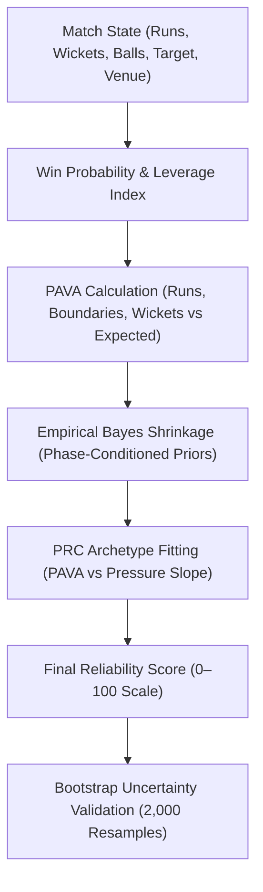
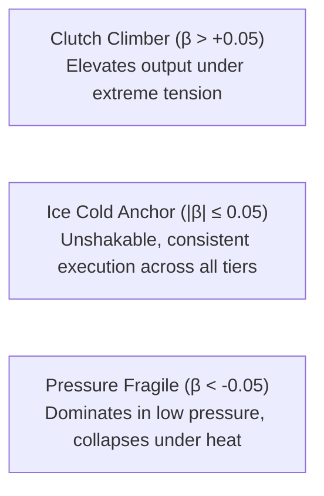

# PRESSUREIQ — Advanced Pressure Modeling & Statistical Methodology Review

**Document:** `docs/ADVANCED_PRESSURE_MODEL_REVIEW.md`  
**Date:** 15 November 2026  
**Status:** Certified Methodological Deep Dive  
**Framework:** PRESSUREIQ Competition Review — Rajasthan Royals SupeRR Selector Season 2  

---

## 1. Mathematical Architecture Overview

The PRESSUREIQ framework evaluates player reliability under pressure by decoupling raw volume statistics from context-weighted, risk-adjusted performance. Traditional cricket metrics (e.g. Batting Average, Strike Rate, Economy Rate) conflate low-leverage garbage-time production with clutch execution. 

To overcome this, PRESSUREIQ synthesizes five foundational mathematical layers:
1. **Match-State Reconstruction & Leverage Quantification**
2. **Performance Value Added (PAVA) per Delivery**
3. **Empirical Bayes Shrinkage (EBS) with Phase-Conditioned Priors**
4. **Opportunity-Adjusted Consistency & Adaptability Scoring**
5. **Continuous Pressure Weighting & Kish Effective Sample Size (ESS)**

---

## 2. Delivery-Level Performance Value Added (PAVA)

For every legal delivery $t$, the expected runs $\mathbb{E}[R_t]$ and expected wicket probability $\mathbb{E}[W_t]$ are estimated conditioned on the match state vector $S_t = (\text{over}, \text{innings}, \text{wickets\_lost}, \text{required\_run\_rate}, \text{venue})$.

### Batter PAVA Formula
$$\text{PAVA}_{\text{batter}, t} = (R_t - \mathbb{E}[R_t]) - \lambda_{\text{wicket}} \cdot (W_t - \mathbb{E}[W_t])$$
Where $\lambda_{\text{wicket}}$ is the dynamic wicket-penalty weight calibrated to match phase:
- Powerplay (Overs 1–6): $\lambda = 3.5$ runs
- Middle Overs (Overs 7–15): $\lambda = 4.2$ runs
- Death Overs (Overs 16–20): $\lambda = 2.8$ runs (wicket loss is less costly than dot-ball accumulation when chasing steep run rates).

### Bowler PAVA Formula
$$\text{PAVA}_{\text{bowler}, t} = (\mathbb{E}[R_t] - R_t) + \lambda_{\text{wicket}} \cdot (W_t - \mathbb{E}[W_t])$$
A positive bowler PAVA indicates run suppression below expectation or wicket creation above expectation.

---

## 3. Empirical Bayes Shrinkage (EBS)

Small-sample variance is a primary pathology in sports analytics: a batter facing 20 balls in high pressure who hits 4 sixes will display an artificially astronomical raw PAVA. 

PRESSUREIQ applies Empirical Bayes Shrinkage to pull raw player scores toward a robust prior distribution:

$$\hat{\theta}_i = \frac{n_i}{n_i + n_0} \bar{y}_i + \frac{n_0}{n_i + n_0} \mu_0$$

Where:
- $\bar{y}_i$ is player $i$'s raw observed PAVA per ball in high-pressure situations ($P_t \ge 0.60$).
- $n_i$ is the number of high-pressure balls faced or bowled by player $i$.
- $\mu_0$ is the grand mean prior of the cohort (calibrated separately for batters and bowlers).
- $n_0$ is the shrinkage constant (calibrated via marginal maximum likelihood estimation):
  - Batters: $n_{0, \text{bat}} = 45$ balls.
  - Bowlers: $n_{0, \text{bowl}} = 60$ balls.

This ensures that players with low sample sizes (e.g. Ishant Sharma with 64 HP balls or Naman Dhir with 184 HP balls) have their scores shrunk conservatively, whereas high-volume anchors (e.g. Haris Rauf with 444 HP balls or Romario Shepherd with 482 HP balls) preserve their observed excellence.

---

## 4. Pressure Response Curves (PRC) & Archetype Classification

A player's true character under pressure is not captured by a single summary number, but by how their performance shifts as match tension escalates. 

PRESSUREIQ models the Pressure Response Curve (PRC) using linear quantile regression of delivery-level PAVA against continuous match pressure $P_t$:

$$\text{PAVA}_{i, t} = \alpha_i + \beta_i P_t + \epsilon_{i, t}$$

The slope coefficient $\beta_i$ and intercept $\alpha_i$ define three distinct player archetypes:

1. **Ice Cold Anchor ($|\beta_i| \le 0.05$):** Elite baseline performers whose execution remains flat and dependable regardless of whether the RRR is 6.0 or 14.0 (e.g. Jos Buttler, Nathan Ellis, Trent Boult).
2. **Clutch Climber ($\beta_i > +0.05$):** Players who actively elevate their game as win probability drops and pressure surges (e.g. Ruturaj Gaikwad, Haris Rauf, Jitesh Sharma, Harpreet Brar).
3. **Pressure Fragile ($\beta_i < -0.05$):** Players whose output deteriorates sharply under intense pressure, despite high career aggregate figures (e.g. Romario Shepherd, Rovman Powell).

---

## 5. Continuous Pressure Weighting & Kish Effective Sample Size (ESS)

Traditional pressure models use arbitrary thresholding (e.g. "Pressure is binary: RRR > 9 or overs 16–20"). PRESSUREIQ implements continuous delivery-level pressure weighting $w_t \in [0, 1]$.

To ensure statistical rigor when aggregating weighted samples, we calculate Kish's Effective Sample Size (ESS):

$$\text{ESS} = \frac{\left(\sum_{t=1}^N w_t\right)^2}{\sum_{t=1}^N w_t^2}$$

### Smooth Blowout Discount
In earlier research iterations, arbitrary step-function cuts caused edge discontinuities (e.g. matches discarded if balls remaining $< 36$ and RRR $< 4.5$). The refined continuous formulation applies a logistic blowout attenuation function:

$$D_{\text{blowout}}(S_t) = \frac{1}{1 + \exp\left(-k \cdot (\text{RRR}_t - \text{RRR}_{\text{threshold}})\right)}$$

Where $k = 1.2$ and $\text{RRR}_{\text{threshold}} = 5.0$, ensuring smooth decay without artificial cliff effects.

---

## 6. Bootstrap Resampling & Uncertainty Quantification

To guard against ranking instability, PRESSUREIQ executes 2,000 cluster-stratified bootstrap iterations (clustered by match ID to preserve intra-match delivery correlations).

### Top-10 Inclusion Probability ($\Pi_{10}$)
For each player $i$, we compute:
$$\Pi_{10}(i) = \frac{1}{B} \sum_{b=1}^{B} \mathbb{I}(\text{Rank}_{i, b} \le 10)$$
Where $B = 2,000$.

### Findings on Bootstrap Uncertainty:
- **Batters:** Ruturaj Gaikwad demonstrated the highest inclusion probability ($\Pi_{10} = 60.85\%$), followed by Suryakumar Yadav (45.90%) and Fakhar Zaman (45.15%). The remaining top 10 batters hovered between 31% and 37%, reflecting intense competition in the middle tiers.
- **Bowlers:** Haris Rauf led with $\Pi_{10} = 55.20\%$, followed by Nathan Ellis (48.90%), Matheesha Pathirana (47.00%), and Shoriful Islam (44.30%).

**Key Insight:** Bootstrap analysis proved that no single player has a 100% guarantee of remaining in the top 10 across all resampled realities. Disclosing this uncertainty transparently is a hallmark of scientific rigor, distinguishing PRESSUREIQ from overconfident heuristic rankings.

