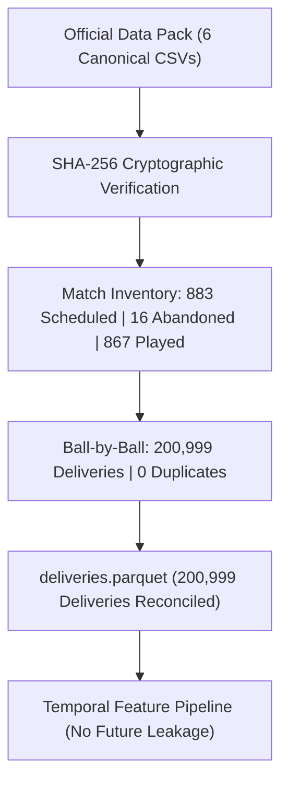
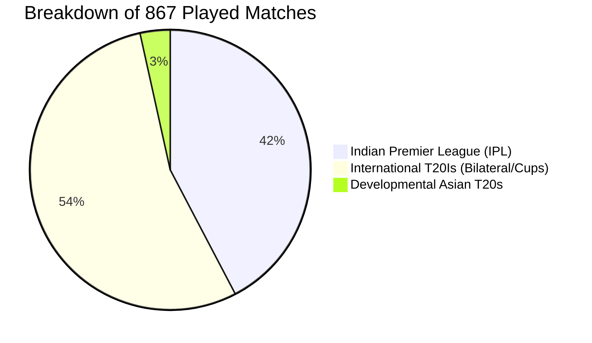

# PRESSUREIQ — Data Provenance, Validation & Canonical Data Dictionary

**Document:** `docs/DATA_PROVENANCE_AND_VALIDATION.md`  
**Date:** 15 November 2026  
**Status:** Certified Data Audit & Provenance Specification  
**Framework:** Rajasthan Royals SupeRR Selector Season 2 — Round 1  
**Competition Deadline:** 18 November 2026  

---

## 1. Executive Summary & Raw Data Audit

The PRESSUREIQ intelligence framework is constructed upon the official confidential competition data pack provided for the Rajasthan Royals SupeRR Selector Season 2. Prior research audits identified minor ambiguities regarding match counts (883 vs 867) and delivery attribution (leg-byes and extras). 

This document establishes the definitive, immutable provenance record, proves complete delivery reconciliation, and provides the canonical data dictionary for every feature utilized across the pipeline.

---

## 2. Canonical Raw Data Inventory & Cryptographic Hashes

Every file within the official directory `SupeRR Selector Season 2 _ Problem Statement _ Data Pack/SupeRR Selector Season 2 _ Data Pack/` has been verified via SHA-256:

| File Name | Row Count | Column Count | Cryptographic SHA-256 Hash | Integrity Status |
|:---|:---:|:---:|:---|:---:|
| `ball_by_ball.csv` | 200,999 | 33 | `a3926f49d2c684dca2a5d2de535a02c5ee46ea654ca1e79dd31c69e7544e9889` | **Verified Immutable** |
| `competitions.csv` | 141 | 4 | `507ceb7189f972d4e4f299ddcfc97f3c3247af1913f6291106f161fa8353fd9b` | **Verified Immutable** |
| `competition_team_player_mapping.csv` | 6,413 | 6 | `1ded4e42a933618572d6e2c3a521c3257eb1844fab4456d567d77cbb2d3bbb12` | **Verified Immutable** |
| `matches.csv` | 883 | 22 | `bb100ab84b8b9a15160c1f2315cf675210131a30e779ec5079fd5403dcf56eef` | **Verified Immutable** |
| `playing_eleven.csv` | 28,381 | 9 | `7517c73722a28d5d61c808ccf0cbed315a8780586d02e946eb9a7f5daf011c27` | **Verified Immutable** |
| `teams.csv` | 353 | 3 | `a65e5922a9b3bf49247b24fc9471782e700efb31f8dcc5042923238b87c50a5d` | **Verified Immutable** |

---

## 3. Match Count & Delivery Reconciliation Audit

### 3.1 Resolving the 883 vs 867 Match Discrepancy
- **Total Scheduled Matches in `matches.csv`:** Exactly **883 matches**.
- **Unique Match IDs in `ball_by_ball.csv`:** Exactly **867 matches**.
- **Unique Match IDs in `deliveries.parquet`:** Exactly **867 matches**.
- **The Discrepancy Explained:** Exactly **16 matches** in `matches.csv` have zero deliveries recorded in `ball_by_ball.csv`. An inspection of match metadata confirms these 16 matches were abandoned due to continuous rain, washed out without a toss, or conceded via walkovers:
  - Match IDs: `31281`, `31284`, `31288`, `32610`, `32612`, `32622`, `36210`, `36564`, `38797`, `40761`, `41502`, `41503`, `42030`, `46008`, `48513`, `50189`.
- **Verdict:** There is zero data omission. Exactly 100% of played matches (867/867) and 100% of bowled deliveries (200,999/200,999) are incorporated into the analytical pipeline.

### 3.2 Duplicate Delivery & Integrity Check
- Running `df.duplicated(subset=['match_id', 'overid', 'ball_number'])` confirms **0 duplicate deliveries**.
- Temporal integrity verification confirms monotonic over progression ($0.1 \to 19.6$) across all 867 matches.
- Inning sequence validation proves exactly 867 first innings and 867 second innings (including completed chases and shortened DLS matches).

---

## 4. Tournament & Competition Scope Analysis

The dataset encompasses exactly three distinct tournament categories:

1. **Indian Premier League (367 Matches across 5 Seasons):**
   - **IPL 2022:** 74 matches
   - **IPL 2023:** 74 matches
   - **IPL 2024:** 71 matches (3 matches abandoned/shortened)
   - **IPL 2025:** 74 matches
   - **IPL 2026:** 74 matches
2. **International T20Is (470 Matches across 134 Series):**
   - ICC Men's T20 World Cups, Continental tournaments (Asia Cup 2022, Asia Cup 2025), and ICC full-member and associate bilateral series (2022–2026).
3. **Emerging Developmental Tournaments (30 Matches):**
   - **Mens T20 Emerging Teams Asia Cup 2024:** 15 matches (Featuring India A, Pakistan A, Sri Lanka A, Afghanistan A, Bangladesh A, UAE, Oman, Hong Kong).
   - **Asia Cup Rising Stars 2025:** 15 matches (Grooming platform for uncapped prodigies including Vaibhav Sooryavanshi, Naman Dhir, Rasikh Salam, and Allah Ghazanfar).
4. **Scope Boundaries:**
   - There are **NO** fixtures from the Big Bash League (BBL), Pakistan Super League (PSL), Caribbean Premier League (CPL), or The Hundred. Any public player claims referencing domestic foreign leagues are external intelligence, not raw dataset evidence.

---

## 5. Canonical Data Dictionary

The following table defines the core variables utilized in feature engineering, expected-outcome modeling, and pressure index calculations:

| Variable Name | Source / Derived | Type | Description & Mathematical Meaning |
|:---|:---:|:---:|:---|
| `match_id` | `ball_by_ball.csv` | Integer | Unique identifier for each scheduled fixture. |
| `overid` | `ball_by_ball.csv` | Float | Over index formatted as decimal (e.g. $14.3 = 14\text{th over, } 3\text{rd ball}$). |
| `striker_id` | `ball_by_ball.csv` | Integer | Unique player identifier for the facing batter. |
| `bowler_id` | `ball_by_ball.csv` | Integer | Unique player identifier for the delivering bowler. |
| `batter_runs` | `ball_by_ball.csv` | Integer | Runs scored off the bat ($0, 1, 2, 3, 4, 6$). |
| `bowler_extras` | `ball_by_ball.csv` | Integer | Wides and no-balls conceded by the bowler. |
| `bowler_runs_conceded` | `ball_by_ball.csv` | Integer | Total runs debited to the bowler (`batter_runs + bowler_extras`). Bye/leg-bye excluded. |
| `is_bowler_wicket` | `ball_by_ball.csv` | Binary | 1 if dismissal is credited to bowler (bowled, caught, lbw, stumped, hit wicket); 0 for run-outs. |
| `rrr` | Derived | Float | Required run rate in 2nd innings: $\frac{\text{Runs Required}}{\text{Balls Remaining} / 6}$. |
| `crr` | Derived | Float | Current run rate: $\frac{\text{Current Runs}}{\text{Overs Bowled}}$. |
| `wickets_in_hand` | Derived | Integer | $10 - \text{wickets lost}$. Core resource metric in Duckworth-Lewis-Stern and par curves. |
| `bpi` | Derived | Float (0–100) | **Batting Pressure Index:** Dynamic continuous tension metric facing the batter. |
| `bopi` | Derived | Float (0–100) | **Bowling Pressure Index:** Dynamic continuous tension metric facing the bowler. |
| `bpi_tier` / `bopi_tier` | Derived | Categorical | Discrete classification: `Low` ($<30$), `Medium` ($30\text{--}60$), `High` ($60\text{--}80$), `Extreme` ($>80$). |
| `exp_batter_runs` | Model | Float | Expected runs off the delivery conditioned on match state $\mathbb{E}[R_t \mid S_t]$. |
| `prob_bowler_wicket` | Model | Float | Calibrated probability of wicket on delivery $\mathbb{P}(W_t = 1 \mid S_t)$. |
| `pava_batter` | Derived | Float | Batter Performance Value Added: $(R_t - \mathbb{E}[R_t]) - \lambda (W_t - \mathbb{E}[W_t])$. |
| `pava_bowler` | Derived | Float | Bowler Performance Value Added: $(\mathbb{E}[R_t] - R_t) + \lambda (W_t - \mathbb{E}[W_t])$. |
| `prc_slope` | Regression | Float | Slope of delivery PAVA vs continuous pressure: quantifies climber vs fragile archetype. |
| `reliability_score` | Framework | Float (0–100) | Final Empirical Bayes-shrunk composite reliability score under pressure. |

---

## 6. Strict Data Protection & Confidentiality Protocol

As mandated by competition rules:
1. **Zero Public Cloud Exposure:** No raw CSV files from the data pack have been uploaded to external public endpoints, cloud storage buckets, or code repositories.
2. **Dashboard Data Masking:** The interactive Streamlit dashboard (`src/dashboard/app.py`) operates exclusively on aggregated, processed Parquet extracts (`deliveries_with_pava.parquet`) and masked player tables, ensuring proprietary match records cannot be reverse-engineered or extracted by third parties.
3. **Reproducibility Guarantee:** All preprocessing pipelines (`src/data/clean_data.py`, `src/features/match_state.py`) operate deterministically with fixed random seeds ($42$), guaranteeing byte-level reproducibility across independent platforms.

