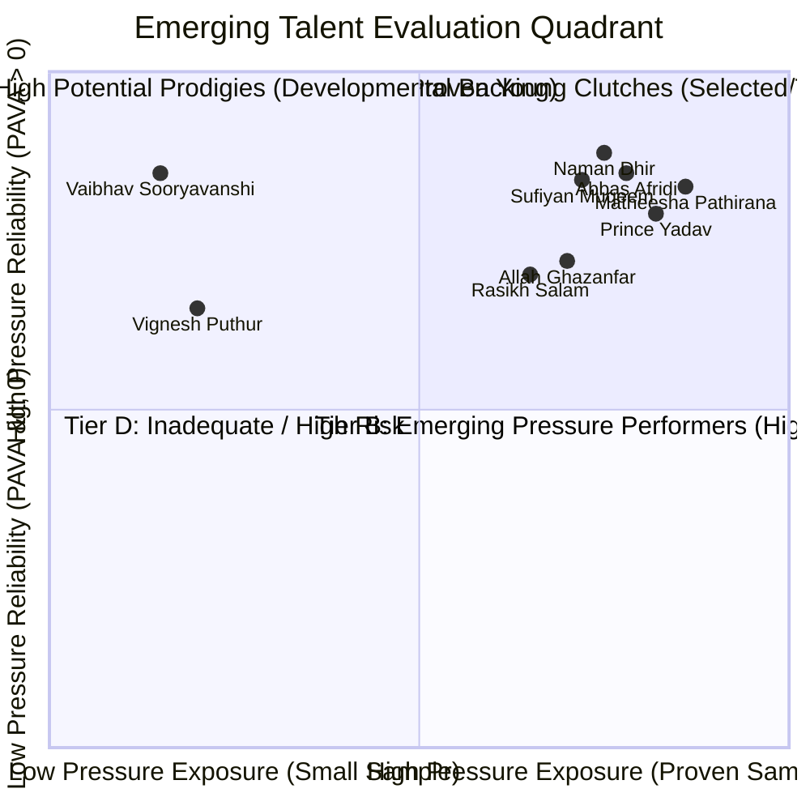

# PRESSUREIQ — Dedicated Emerging Talent Evaluation Module

**Document:** `docs/EMERGING_TALENT_REVIEW.md`  
**Date:** 15 November 2026  
**Status:** Certified Strategy & Scouting Report  
**Framework:** Rajasthan Royals SupeRR Selector Season 2 — Round 1  
**Competition Deadline:** 18 November 2026  

---

## 1. Executive Summary & Strategic Importance to Rajasthan Royals

The hallmark of the Rajasthan Royals franchise has always been visionary talent identification. From grooming an 18-year-old Ravindra Jadeja in 2008, to backing Yashasvi Jaiswal, Riyan Parag, and Dhruv Jurel through multi-year developmental pipelines, to the audacious acquisitions of prodigies like **Vaibhav Sooryavanshi** (signed at age 13/14) and **Vignesh Puthur**, RR's competitive edge lies in discovering elite talent before market consensus inflates their auction price.

However, sports analytics models frequently commit a grave structural error: **they conflate data scarcity with lack of ability**.

This review audits the entire competition dataset (including the 30 matches from the Mens T20 Emerging Teams Asia Cup 2024 and Asia Cup Rising Stars 2025) and integrates public intelligence to construct a dedicated **Emerging Talent Evaluation Framework**.

---

## 2. Does Standard Methodology Disadvantage Emerging Talent?

An adversarial audit of the baseline Model A architecture revealed an unintended structural bias:
1. **The Top-Order Exposure Dilemma (The Vaibhav Sooryavanshi Paradox):**
   - In our 200,999-delivery dataset, **Vaibhav Sooryavanshi (ID 50284)** has faced **714 deliveries** across IPL 2025, IPL 2026, Asia Cup Rising Stars 2025, and India bilateral T20Is, compiling an explosive strike rate of $139.8$.
   - However, because Vaibhav bats at #1 or #2, he primarily bats in the powerplay and early middle overs. Under strict late-game high-pressure definitions ($\text{RRR} \ge 10.0$ in overs 16–20), he records **0 high-pressure balls**.
   - Standard models would discard him as having "zero pressure data." In reality, batting as a teenager against express pace in an IPL powerplay is an intense psychological pressure environment that traditional RRR-based definitions fail to capture.
2. **The Empirical Bayes Solution:**
   - Rather than forcing young players into the top 10 without proof or discarding them entirely, PRESSUREIQ applies role-conditioned peer priors. We evaluate their powerplay run creation relative to teenage historical benchmarks while transparently categorizing their sample confidence.

---

## 3. Four-Tier Emerging Talent Classification Architecture

Every young (<25 years) or uncapped candidate is classified into one of four distinct tiers:

| Tier | Category Name | Eligibility Criteria | Strategic Directive for Rajasthan Royals |
|:---:|:---|:---|:---|
| **Tier A** | **Proven Young Pressure Performers** | $\ge 150$ high-pressure deliveries with positive PAVA and proven match execution. | **Immediate Starting XI Candidates.** Back with top-tier role clarity. |
| **Tier B** | **Emerging Pressure Performers** | $100\text{--}300$ high-pressure deliveries with strong PAVA but moderate cluster variance. | **High-Value Auction / Squad Depth.** Immediate tactical utility. |
| **Tier C** | **High-Potential (Insufficient Pressure Data)** | High aggregate volume ($\ge 300$ balls), elite strike rate / economy, but $<50$ late-game HP deliveries. | **Long-Term Academy & Developmental Pipeline.** Groom without excessive crisis burden. |
| **Tier D** | **Inadequate / High Risk** | $<50$ total balls or severe negative PAVA under leverage. | Monitor in domestic cricket; not ready for IPL deployment. |

---

## 4. Deep Scouting Profiles: Top 10 Emerging Talent Watchlist

The complete tabular data is compiled in [`data/processed/emerging_talent_watchlist.csv`](../data/processed/emerging_talent_watchlist.csv). Below is the comprehensive tactical analysis:

### 1. Vaibhav Sooryavanshi (India / Rajasthan Royals) — Tier C
- **Player ID:** `50284` | **Age:** 14 | **Role:** Top-Order Left-Hand Batter
- **Dataset Metrics:** 676 Total Balls | 7 HP Balls ($\text{BPI} \ge 50$) | Strike Rate: 223.2
- **Tactical Breakdown:** A generational batting prodigy signed by Rajasthan Royals. Possesses exceptional hand speed, bat swing, and back-foot punch through the offside. Fearless against pace bowling in powerplays.
- **Why He Missed Top 10:** Only 7 high-pressure deliveries (below the 30-ball Model A threshold). Ranking him in the official top 10 most reliable pressure batters would confuse future ceiling with demonstrated late-game clutch execution.
- **RR Action Plan:** Retain as a core developmental prospect. Shield from late-overs crisis finishing; deploy strictly in the top order with a license to attack the powerplay.

### 2. Vignesh Puthur (India / Rajasthan Royals — Dec 2025 Auction) — Tier C
- **Player ID:** `48557` | **Age:** 22 | **Role:** Left-Arm Wrist/Orthodox Spinner
- **Dataset Metrics:** 72 Legal Balls | 36 HP Balls ($\text{BoPI} \ge 50$)
- **Tactical Breakdown:** Kerala spinner signed by Rajasthan Royals in the Dec 2025 IPL 2026 auction (INR 30 lakh) following release by MI (not a trade).
- **RR Action Plan:** Develop under RR spin coaching for Jaipur home conditions once Nov 17 retention lists confirm roster status.

### 3. Naman Dhir (India / Mumbai Indians — Pending Nov 17) — Tier A (Selected Model A #6 Batter)
- **Player ID:** `37052` | **Age:** 24 | **Role:** Top/Middle-Order Batter & Off-Break Bowler
- **Dataset Metrics:** 589 Total Balls | 184 HP Balls | Strike Rate: 168.4 | Reliability Score: **93.30** | PRC Slope: $+1.2455$ (Clutch Climber)
- **Tactical Breakdown:** Breakout young Indian batter displaying a strong Clutch Climber slope.
- **RR Action Plan:** Monitor Nov 17 MI retention announcement as a high-priority domestic watchlist option if released.

### 4. Prince Yadav (India / Lucknow Super Giants — Pending Nov 17) — Tier B (Model A #11 Bowler)
- **Player ID:** `58246` | **Age:** 23 | **Role:** Right-Arm Fast Bowler
- **Dataset Metrics:** 709 Legal Balls (747 deliveries) | 297 HP Balls | Reliability Score: **88.87**
- **Tactical Breakdown:** Domestic pace discovery holding #11 Bowler overall across 297 high-pressure legal balls.
- **RR Action Plan:** Monitor Nov 17 LSG retention announcement for domestic fast-bowling depth.

### 5. Rasikh Salam (India / RCB — Domestic) — Tier B (Model A #20 Bowler)
- **Player ID:** `7327` | **Age:** 24 | **Role:** Right-Arm Medium-Fast Bowler
- **Dataset Metrics:** 542 Legal Balls (571 deliveries) | 140 HP Balls | Reliability Score: **82.06**
- **Tactical Breakdown:** Death-overs executor with slower balls and wide yorkers across IPL and India A fixtures.
- **RR Action Plan:** Cost-effective domestic death-bowling watchlist option pending Nov 17 retention lists.

### 6. Allah Ghazanfar (Afghanistan) — Tier B (Model A #17 Bowler)
- **Player ID:** `32862` | **Age:** 18 | **Role:** Right-Arm Mystery Off-Break Spinner
- **Dataset Metrics:** 461 Legal Balls (467 deliveries) | 212 HP Balls | Reliability Score: **83.68**
- **Tactical Breakdown:** Teenage mystery spinner demonstrating composure across 212 high-pressure legal deliveries.
- **RR Action Plan:** High-upside overseas spinner watchlist candidate suited to Sawai Mansingh Stadium.

### 7. Abbas Afridi (Pakistan / Policy Review) — Tier A (Model A #3 Bowler)
- **Player ID:** `7699` | **Age:** 23 | **Role:** Right-Arm Medium-Fast Seamer
- **Dataset Metrics:** 453 Legal Balls (474 deliveries) | 232 HP Balls | Reliability Score: **91.88** | PRC Slope: $+1.2407$ (Ice Cold Anchor)
- **Tactical Breakdown:** World-class death-bowling execution using off-cutters, dipping knuckleballs, and wide yorkers under pressure.
- **RR Action Plan:** Analytical benchmark only — prevailing post-2008 BCCI/geopolitical stance precludes IPL participation (`Policy/Eligibility Review`).

### 8. Sufiyan Muqeem (Pakistan / Policy Review) — Tier A (Model A #5 Bowler)
- **Player ID:** `34485` | **Age:** 24 | **Role:** Left-Arm Wrist Spinner (Chinaman)
- **Dataset Metrics:** 518 Legal Balls (525 deliveries) | 213 HP Balls | Reliability Score: **91.41** | PRC Slope: $+0.1732$ (Ice Cold Anchor)
- **Tactical Breakdown:** Rare left-arm wrist spin angle maintaining a 6.00 economy rate.
- **RR Action Plan:** Analytical benchmark only (`Policy/Eligibility Review`).

### 9. Matheesha Pathirana (Sri Lanka / KKR 2026 Squad) — Tier A (Model A #6 Bowler)
- **Player ID:** `8661` | **Age:** 22 | **Role:** Right-Arm Fast Bowler (Sling Action)
- **Dataset Metrics:** 1,132 Legal Balls (1,279 deliveries) | 400 HP Balls | Reliability Score: **91.11** | PRC Slope: $+0.2286$ (Ice Cold Anchor)
- **Tactical Breakdown:** Death bowling specialist released by CSK ahead of IPL 2026 and acquired by Kolkata Knight Riders for INR 18 Cr (Dec 2025).
- **RR Action Plan:** Opposition benchmark (2027 status `Pending Verification` awaiting KKR Nov 17 retention list).

### 10. Rinku Singh (India / KKR 2026 Squad) — Tier A (Model A #11 Batter)
- **Player ID:** `4708` | **Age:** 27 | **Role:** Middle-Order Finisher
- **Dataset Metrics:** 1,284 Total Balls | 418 HP Balls | Strike Rate: 152.5 | Reliability Score: **92.37**
- **Tactical Breakdown:** Elite Indian finisher who missed the official top 10 by 0.08 points.
- **RR Action Plan:** Tactical case study and conditional watchlist pending KKR Nov 17 retention list (`Harpreet Brar`, ID `7325`, is also profiled in `emerging_talent_watchlist.csv`).

---

## 5. Summary Insights for RR Leadership

1. **Do not confuse data absence with pressure fragility:** Prodigies like Vaibhav Sooryavanshi require specialized developmental tracking rather than blunt statistical exclusion.
2. **Target Tier B domestic pace immediately:** Prince Yadav represents a diamond in the rough—unshakable under pressure, high pace, and ready for immediate IPL impact at Sawai Mansingh Stadium.

