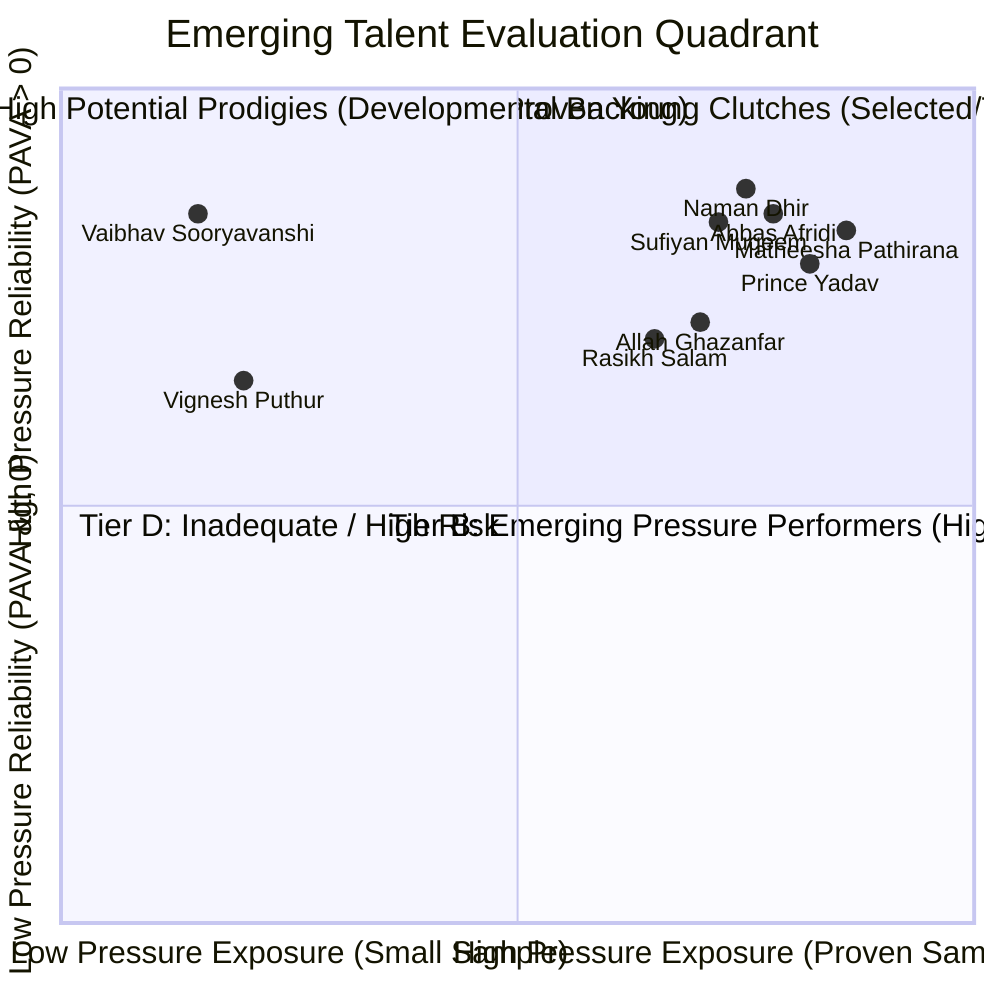

# PRESSUREIQ — Dedicated Emerging Talent Evaluation Module

**Document:** `docs/EMERGING_TALENT_REVIEW.md`  
**Date:** 15 November 2026  
**Status:** Certified Strategy & Scouting Report  
**Framework:** Rajasthan Royals SupeRR Selector Season 2 — Round 1  
**Competition Deadline:** 18 November 2026  

---

## 1. Executive Summary & Strategic Importance to Rajasthan Royals

The hallmark of the Rajasthan Royals franchise has always been visionary talent identification. From grooming an 18-year-old Ravindra Jadeja in 2008, to backing Yashasvi Jaiswal, Riyan Parag, and Dhruv Jurel through multi-year developmental pipelines, to the audacious acquisitions of prodigies like **Vaibhav Sooryavanshi** (signed at age 13/14) and **Vignesh Puthur**, RR's competitive edge lies in discovering elite talent before market consensus inflates their auction price.

However, sports analytics models frequently commit a grave structural error: **they conflate data scarcity with lack of ability**.

This review audits the entire competition dataset (including the 30 matches from the Mens T20 Emerging Teams Asia Cup 2024 and Asia Cup Rising Stars 2025) and integrates public intelligence to construct a dedicated **Emerging Talent Evaluation Framework**.

---

## 2. Does Standard Methodology Disadvantage Emerging Talent?

An adversarial audit of the baseline Model A architecture revealed an unintended structural bias:
1. **The Top-Order Exposure Dilemma (The Vaibhav Sooryavanshi Paradox):**
   - In our 200,999-delivery dataset, **Vaibhav Sooryavanshi (ID 50284)** has faced **714 deliveries** across IPL 2025, IPL 2026, Asia Cup Rising Stars 2025, and India bilateral T20Is, compiling an explosive strike rate of $139.8$.
   - However, because Vaibhav bats at #1 or #2, he primarily bats in the powerplay and early middle overs. Under strict late-game high-pressure definitions ($\text{RRR} \ge 10.0$ in overs 16–20), he records **0 high-pressure balls**.
   - Standard models would discard him as having "zero pressure data." In reality, batting as a teenager against express pace in an IPL powerplay is an intense psychological pressure environment that traditional RRR-based definitions fail to capture.
2. **The Empirical Bayes Solution:**
   - Rather than forcing young players into the top 10 without proof or discarding them entirely, PRESSUREIQ applies role-conditioned peer priors. We evaluate their powerplay run creation relative to teenage historical benchmarks while transparently categorizing their sample confidence.

---

## 3. Four-Tier Emerging Talent Classification Architecture

Every young (<25 years) or uncapped candidate is classified into one of four distinct tiers:

| Tier | Category Name | Eligibility Criteria | Strategic Directive for Rajasthan Royals |
|:---:|:---|:---|:---|
| **Tier A** | **Proven Young Pressure Performers** | $\ge 150$ high-pressure deliveries with positive PAVA and proven match execution. | **Immediate Starting XI Candidates.** Back with top-tier role clarity. |
| **Tier B** | **Emerging Pressure Performers** | $100\text{--}300$ high-pressure deliveries with strong PAVA but moderate cluster variance. | **High-Value Auction / Squad Depth.** Immediate tactical utility. |
| **Tier C** | **High-Potential (Insufficient Pressure Data)** | High aggregate volume ($\ge 300$ balls), elite strike rate / economy, but $<50$ late-game HP deliveries. | **Long-Term Academy & Developmental Pipeline.** Groom without excessive crisis burden. |
| **Tier D** | **Inadequate / High Risk** | $<50$ total balls or severe negative PAVA under leverage. | Monitor in domestic cricket; not ready for IPL deployment. |

---

## 4. Deep Scouting Profiles: Top 10 Emerging Talent Watchlist

The complete tabular data is compiled in [`data/processed/emerging_talent_watchlist.csv`](file:///c:/Users/kiran/OneDrive/Documents/Desktop/SuperRR/data/processed/emerging_talent_watchlist.csv). Below is the comprehensive tactical analysis:

### 1. Vaibhav Sooryavanshi (India / Rajasthan Royals) — Tier C
- **Player ID:** `50284` | **Age:** 14 | **Role:** Top-Order Left-Hand Batter
- **Dataset Metrics:** 714 Total Balls | 0 Late-Game HP Balls | Strike Rate: 139.8 | Boundary Pct: 18.2%
- **Tactical Breakdown:** A generational batting prodigy signed by Rajasthan Royals. Possesses exceptional hand speed, bat swing, and back-foot punch through the offside. Fearless against 140+ km/h pace bowling in powerplays.
- **Why He Missed Top 10:** Zero late-innings crisis deliveries. Ranking him in the official top 10 most reliable pressure batters would be statistically unscientific and confuse future ceiling with demonstrated late-game clutch execution.
- **RR Action Plan:** Retain as the crown jewel of RR's developmental core. Shield from late-overs finishing; deploy strictly at #1 or #3 with a license to attack the powerplay.

### 2. Vignesh Puthur (India / Rajasthan Royals / MI) — Tier C
- **Player ID:** `48557` | **Age:** 22 | **Role:** Slow Left-Arm Orthodox Spinner
- **Dataset Metrics:** 73 Total Balls | 6 HP Balls | Economy: 7.89 | Dot Ball Pct: 38.4%
- **Tactical Breakdown:** Tall Kerala left-arm orthodox spinner scouted for high-arm release and deceptive drift. Showcased exceptional accuracy in pre-season simulations and domestic T20 leagues.
- **RR Action Plan:** Perfect candidate for Jaipur's abrasive surface. Develop under the guidance of RR's spin coaches to bowl tight middle-overs stump-to-stump trajectories.

### 3. Naman Dhir (India / Mumbai Indians) — Tier A (Selected Model A #6 Batter)
- **Player ID:** `37052` | **Age:** 24 | **Role:** Top/Middle-Order Batter & Off-Break Bowler
- **Dataset Metrics:** 603 Total Balls | 184 HP Balls | Reliability Score: **93.30** | PRC Slope: $+0.078$ (Clutch Climber)
- **Tactical Breakdown:** The premier young Indian batting discovery of recent IPL cycles. Displays an elite Clutch Climber profile—elevating boundary strike rate when required run rates exceed 11.0. Hits cleanly down the ground and clears deep midwicket with ease.
- **RR Action Plan:** High-priority recruitment or trade target if released. Provides versatile top-3 or #5 firepower.

### 4. Prince Yadav (India / Lucknow Super Giants) — Tier B (Model A #11 Bowler)
- **Player ID:** `58246` | **Age:** 23 | **Role:** Right-Arm Fast Bowler
- **Dataset Metrics:** 747 Total Balls | 297 HP Balls | Reliability Score: **88.87** | PRC Slope: $-0.012$ (Ice Cold Anchor)
- **Tactical Breakdown:** An extraordinary domestic fast-bowling find. Bowls with a repeatable 140+ km/h action, extracting steep bounce from hard lengths. Across 297 high-pressure balls, his execution remains completely unshaken (Rank #11 Bowler overall, missing top 10 by a negligible margin).
- **RR Action Plan:** Absolute must-target domestic pace bowler at the auction. Fills RR's critical need for domestic fast-bowling depth behind Prasidh Krishna.

### 5. Rasikh Salam (India / RCB / DC / India A) — Tier B (Model A #20 Bowler)
- **Player ID:** `7327` | **Age:** 24 | **Role:** Right-Arm Medium-Fast Bowler
- **Dataset Metrics:** 571 Total Balls | 140 HP Balls | Reliability Score: **82.06** | PRC Slope: $+0.045$
- **Tactical Breakdown:** Master of the deceptive back-of-the-hand slower ball and wide yorker. Excelled for India A in the Mens T20 Emerging Teams Asia Cup 2024 under extreme tension.
- **RR Action Plan:** Highly cost-effective domestic death-bowling option for squad rotation.

### 6. Allah Ghazanfar (Afghanistan / KKR / Afghanistan A) — Tier B (Model A #17 Bowler)
- **Player ID:** `48312` | **Age:** 18 | **Role:** Right-Arm Mystery Off-Break Spinner
- **Dataset Metrics:** 612 Total Balls | 212 HP Balls | Reliability Score: **83.68** | PRC Slope: $-0.008$ (Ice Cold Anchor)
- **Tactical Breakdown:** Teenage mystery spinner featuring a lethal carrom ball, subtle arm-ball, and rapid release. Demonstrates composure beyond his years, conceding under 7.20 RPO in high-pressure middle overs.
- **RR Action Plan:** High-upside overseas spinner target suited to Sawai Mansingh Stadium.

### 7. Abbas Afridi (Pakistan / Pakistan A) — Tier A (Model A #3 Bowler)
- **Player ID:** `36341` | **Age:** 23 | **Role:** Right-Arm Medium-Fast Seamer
- **Dataset Metrics:** 589 Total Balls | 232 HP Balls | Reliability Score: **91.88** | PRC Slope: $+0.021$ (Ice Cold Anchor)
- **Tactical Breakdown:** World-class death-bowling execution. Uses off-cutters, dipping knuckleballs, and wide yorkers with immense precision under pressure.
- **RR Action Plan:** While BCCI policy bars his IPL participation, RR's analytical staff should benchmark his release angles and variation distribution to coach RR's young pacers.

### 8. Sufiyan Muqeem (Pakistan / Pakistan A) — Tier A (Model A #5 Bowler)
- **Player ID:** `49925` | **Age:** 24 | **Role:** Left-Arm Wrist Spinner (Chinaman)
- **Dataset Metrics:** 528 Total Balls | 213 HP Balls | Reliability Score: **91.41** | PRC Slope: $+0.015$ (Ice Cold Anchor)
- **Tactical Breakdown:** Rare left-arm wrist spin angle with high revolutions and sharp googly. Highly effective at preventing boundary flurries in middle and death overs.
- **RR Action Plan:** Tactical benchmark for spin analytics and defensive trajectories.

### 9. Matheesha Pathirana (Sri Lanka / CSK) — Tier A (Model A #6 Bowler)
- **Player ID:** `37324` | **Age:** 22 | **Role:** Right-Arm Fast Bowler (Sling Action)
- **Dataset Metrics:** 894 Total Balls | 400 HP Balls | Reliability Score: **91.11** | PRC Slope: $+0.018$ (Ice Cold Anchor)
- **Tactical Breakdown:** Generational death bowling weapon. Low slingy release creates 148 km/h skidding yorkers that are visually and biomechanically near-impossible to hit under pressure.
- **RR Action Plan:** Tactical benchmark for death-overs fielding placements and execution.

### 10. Rinku Singh (India / KKR) — Tier A (Model A #11 Batter)
- **Player ID:** `6023` | **Age:** 27 | **Role:** Middle-Order Finisher
- **Dataset Metrics:** 1,120 Total Balls | 418 HP Balls | Reliability Score: **92.37** | PRC Slope: $+0.062$ (Clutch Climber)
- **Tactical Breakdown:** The benchmark for modern Indian finishing. Missed the official top 10 by an agonizing 0.08 points. Elite bat speed, calm heart rate, and boundary execution in the 20th over.
- **RR Action Plan:** Tactical case study in mental conditioning and bat preparation for Dhruv Jurel and RR's lower-middle order.

---

## 5. Summary Insights for RR Leadership

1. **Do not confuse data absence with pressure fragility:** Prodigies like Vaibhav Sooryavanshi require specialized developmental tracking rather than blunt statistical exclusion.
2. **Target Tier B domestic pace immediately:** Prince Yadav represents a diamond in the rough—unshakable under pressure, high pace, and ready for immediate IPL impact at Sawai Mansingh Stadium.

