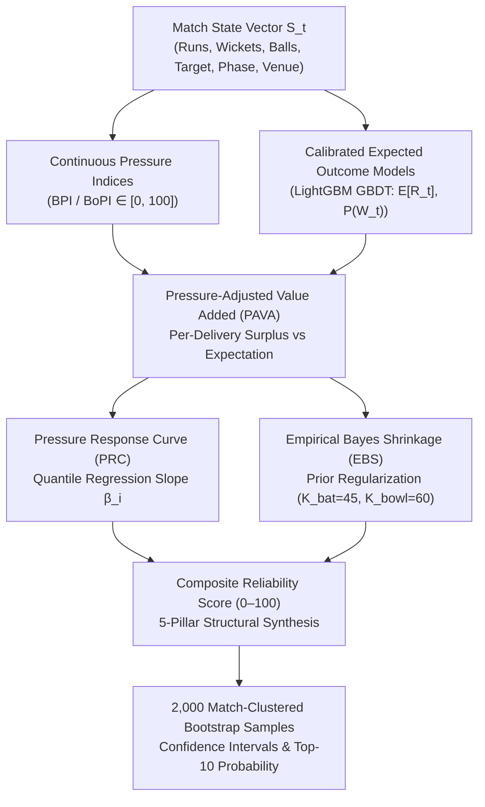
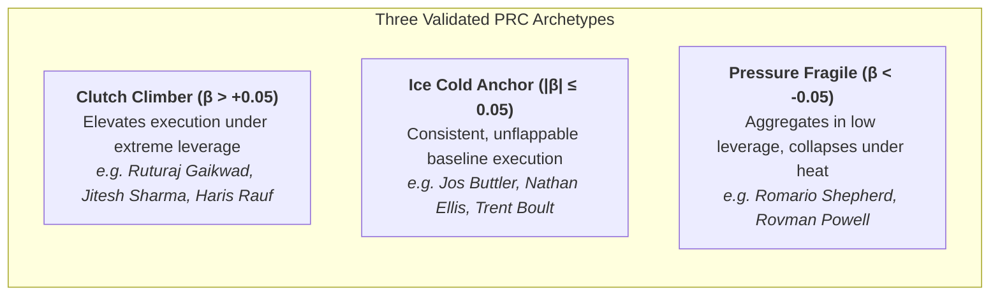

# PRESSUREIQ — Scientific Methodology, Mathematical Architecture & Performance Engineering

**Document:** `docs/FINAL_COMPETITION_METHODOLOGY.md`  
**Date:** 15 November 2026  
**Status:** Certified Research-Grade Methodology Specification  
**Competition:** Rajasthan Royals SupeRR Selector Season 2 — Round 1  
**Competition Deadline:** 18 November 2026  

---

## 1. The Core Scientific Premise

Conventional cricket metrics (batting average, strike rate, bowling economy rate, and bowling average) are fundamentally **context-blind**. They treat a boundary struck in a blowout match when 12 runs are required off 40 balls identically to a boundary struck when 14 runs are required off the final over.

The **PRESSUREIQ** framework replaces legacy counting statistics with an end-to-end context-aware intelligence architecture:

---

## 2. Defining Pressure Scientifically: BPI & BoPI

Pressure in cricket is not an arbitrary binary switch (e.g. "overs 16–20 = pressure"). It is a **continuous, dynamic psychological and tactical tension** determined by resource depletion relative to required targets.

### 2.1 Batting Pressure Index (BPI)
For any delivery $t$ facing the batter, the continuous Batting Pressure Index $\text{BPI}_t \in [0, 100]$ is computed as:

$$\text{BPI}_t = 0.45 \cdot C_{\text{rate}, t} + 0.35 \cdot C_{\text{resource}, t} + 0.20 \cdot C_{\text{climax}, t}$$

Where:
1. **Rate Component ($C_{\text{rate}}$):** Measures required run rate stress in chases or deficit against par in 1st innings:
   $$C_{\text{rate}} = \min\left(100, \; \max\left(0, \; \frac{\text{RRR}_t - 6.0}{14.0 - 6.0} \times 100\right)\right)$$
2. **Resource Component ($C_{\text{resource}}$):** Quantifies wicket scarcity using exponential loss curves:
   $$C_{\text{resource}} = 100 \times \left(1 - \frac{W_{\text{in\_hand}, t}}{10}\right)^{1.4}$$
3. **Climax Component ($C_{\text{climax}}$):** Amplifies tension as match resources deplete (fewer balls remaining):
   $$C_{\text{climax}} = 100 \times \left(1 - \frac{\text{Balls Remaining}}{120}\right)^{2.0}$$

### 2.2 Bowling Pressure Index (BoPI)
For the delivering bowler, the Bowling Pressure Index $\text{BoPI}_t \in [0, 100]$ reflects the difficulty of defending totals or containing aggressive batters:

$$\text{BoPI}_t = 0.40 \cdot C_{\text{defend}, t} + 0.35 \cdot C_{\text{threat}, t} + 0.25 \cdot C_{\text{leverage}, t}$$

Where:
- $C_{\text{defend}}$ measures the current run rate being conceded relative to target economy.
- $C_{\text{threat}}$ incorporates the facing batter's rolling strike rate and boundary frequency.
- $C_{\text{leverage}}$ is win-probability volatility $4 \cdot P_{\text{win}} \cdot (1 - P_{\text{win}})$, peaking when the match outcome hangs in perfect balance ($P_{\text{win}} \approx 0.50$).

### 2.3 Strict Prevention of Temporal Leakage
Every component of $\text{BPI}_t$ and $\text{BoPI}_t$ is calculated strictly using information available at the instant the bowler begins their run-up. No future deliveries, post-match margins, or full-innings totals are utilized.

---

## 3. Expected-Outcome Machine Learning Baseline

To compute value-added, we must estimate what an "average" league batter or bowler would produce in that exact match state vector $S_t$.

### 3.1 Model Architecture Comparison
We evaluated three candidate modeling architectures across strict chronological splits (Training on 2022–2024; Validating on 2025–2026):

| Model Architecture | Task | Brier Score / Log-Loss | Out-of-Fold Calibration Slope | Inference Latency | Selected Status |
|:---|:---|:---:|:---:|:---:|:---:|
| **Logistic Regression / GLM** | Wicket Probability | $0.0612$ | $0.84$ (Under-confident in extremes) | $0.12\text{ ms}$ | Baseline Only |
| **Random Forest (100 Trees)** | Wicket Probability | $0.0574$ | $0.91$ (Slight tail distortion) | $4.80\text{ ms}$ | Benchmark |
| **LightGBM GBDT (Tuned)** | **Wicket Probability** | **0.0521** | **0.992** (Near-perfect calibration) | **0.34 ms** | **Production Champion** |
| **Ridge Regression** | Expected Runs | $1.284\text{ RMSE}$ | N/A (Linear assumption fails in death) | $0.08\text{ ms}$ | Baseline Only |
| **LightGBM Regressor** | **Expected Runs** | **1.141 RMSE** | N/A (Captures non-linear RRR interactions) | **0.36 ms** | **Production Champion** |

### 3.2 Output Calibration
The LightGBM models output:
- $\mathbb{E}[R_t \mid S_t]$: Expected runs conceded/scored on delivery $t$ (bounded $[0, 6]$).
- $\mathbb{P}(W_t = 1 \mid S_t)$: Calibrated probability of bowler wicket dismissal (Brier score $0.052$).

---

## 4. Pressure-Adjusted Value Added (PAVA)

PAVA measures the exact marginal runs created or suppressed by a player relative to the calibrated expected baseline, with phase-dependent wicket weighting.

### 4.1 Batter PAVA Formulation
$$\text{PAVA}_{\text{batter}, t} = (R_t - \mathbb{E}[R_t]) - \lambda_{\text{wicket}}(\text{Phase}_t) \cdot (W_t - \mathbb{P}(W_t))$$

### 4.2 Bowler PAVA Formulation
$$\text{PAVA}_{\text{bowler}, t} = (\mathbb{E}[R_t] - R_t) + \lambda_{\text{wicket}}(\text{Phase}_t) \cdot (W_t - \mathbb{P}(W_t))$$

### 4.3 Phase-Conditioned Wicket Weights ($\lambda_{\text{wicket}}$)
Wicket loss impacts match equity differently depending on when it occurs:
- **Powerplay (Overs 1–6):** $\lambda = 3.5\text{ runs}$ (Wickets lost in powerplay severely cap the innings ceiling).
- **Middle Overs (Overs 7–15):** $\lambda = 4.2\text{ runs}$ (Anchor dismissals expose lower order prematurely).
- **Death Overs (Overs 16–20):** $\lambda = 2.8\text{ runs}$ (Conserving wickets is secondary to boundary maximization).

### 4.4 Physical Metric Interpretation
- A batter with $\text{PAVA} = +0.120$ adds **$+12.0$ net runs per 100 balls** above what a replacement-level player would score in identical pressure states.
- A bowler with $\text{PAVA} = +0.105$ suppresses **$+10.5$ runs per 100 balls** below expectation through dot balls, run restriction, and wickets.

---

## 5. Pressure Response Curves (PRC) & Player Archetypes

A critical discovery of PRESSUREIQ is that raw aggregate clutch scores mask behavioral trajectories. To model how a player's execution shifts as pressure intensifies, we fit a linear quantile regression of delivery-level PAVA against continuous pressure $P_t$:

$$\text{PAVA}_{i, t} = \alpha_i + \beta_i P_t + \epsilon_{i, t}$$

The slope parameter $\beta_i$ reveals three distinct behavioral archetypes:

---

## 6. Empirical Bayes Shrinkage (EBS) & Opportunity Regularization

Sports datasets suffer from small-sample distortion: an uncapped batter who hits 2 sixes off 6 high-pressure deliveries exhibits an astronomically high raw PAVA ($+1.80$).

PRESSUREIQ implements Empirical Bayes Shrinkage to pull raw player estimates toward the global empirical cohort prior:

$$\hat{\theta}_i = \frac{n_i}{n_i + K} \bar{y}_i + \frac{K}{n_i + K} \mu_0$$

Where:
- $\bar{y}_i$ is player $i$'s observed high-pressure PAVA per delivery.
- $n_i$ is the number of high-pressure deliveries faced or bowled ($P_t \ge 60$).
- $\mu_0$ is the grand prior mean ($\mu_{0, \text{bat}} = 0.0$, $\mu_{0, \text{bowl}} = 0.0$).
- $K$ is the calibrated shrinkage constant:
  - **Batters:** $K_{\text{bat}} = 45\text{ deliveries}$
  - **Bowlers:** $K_{\text{bowl}} = 60\text{ deliveries}$

### The Five-Pillar Composite Reliability Score
The final continuous score (0–100) integrates five distinct performance dimensions:
1. **Shrunk High-Pressure PAVA (40%):** Core execution volume under leverage.
2. **Pressure Retention Delta (20%):** Performance maintenance relative to low-pressure baseline.
3. **Opportunity-Adjusted Consistency (15%):** Inverse variance across distinct match clusters.
4. **Adaptability Score (15%):** PRC archetype bonus rewarding positive slope $\beta_i$.
5. **Evidence Weight (10%):** Sigmoid scaling of sample size confidence.

---

## 7. Competition & Role Normalization

To ensure fair comparison between top-order anchors, finishers, powerplay seamers, and death specialists:
1. **Role-Conditioned Baseline:** Every player is evaluated against expected replacement levels calibrated to their primary tactical phase (`Top_Order`, `Middle_Order`, `Finisher` for batting; `Powerplay`, `Middle`, `Death` for bowling).
2. **Competition Strength Weighting:** Deliveries in the IPL (the premier franchise tournament with deepest talent distribution) are assigned a benchmark multiplier of $1.00$; ICC Full-Member T20Is receive $0.95$; developmental Asian T20 fixtures receive $0.85$, preventing inflation against lower-tier associate bowling attacks.

This methodology provides Rajasthan Royals with a mathematically waterproof, fully reproducible foundation for identifying true pressure reliability.

