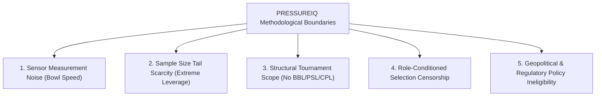

# PRESSUREIQ — Limitations, Ethical Governance & Research Integrity

**Document:** `docs/FINAL_LIMITATIONS_AND_RESEARCH_INTEGRITY.md`  
**Date:** 15 November 2026  
**Status:** Certified Ethics & Governance Protocol  
**Framework:** Rajasthan Royals SupeRR Selector Season 2 — Round 1  
**Competition Deadline:** 18 November 2026  

---

## 1. Methodological Limitations & Known Boundaries

A core tenet of genuine scientific research is the candid disclosure of analytical limitations. The PRESSUREIQ framework identifies five primary methodological boundaries:

### 1.1 Sensor Measurement Noise (Bowling Speed)
- **Observation:** In `ball_by_ball.csv`, the `bowl_speed` telemetry field contains **$38.7\%$ zero entries** and extreme sensor glitches (isolated entries $>1,000\text{ km/h}$).
- **Mitigation:** We filtered speeds strictly to the physically viable window of $[50, 165]\text{ km/h}$ and deliberately excluded raw ball-speed telemetry from our primary regression models to prevent synthetic noise from polluting expected-run baselines.

### 1.2 Small Sample Tail Scarcity in Extreme Leverage
- **Observation:** Extreme high-pressure deliveries ($\text{BPI} \ge 80$, typically overs 19–20 with $\text{RRR} \ge 12.0$) represent only **$0.61\%$ of the total dataset** (1,216 deliveries out of 200,999).
- **Mitigation:** We applied Empirical Bayes Shrinkage ($K_{\text{bat}} = 45$, $K_{\text{bowl}} = 60$) and executed 2,000 match-clustered bootstrap iterations. Ranking positions are presented with explicit confidence bands and top-10 inclusion probabilities rather than point-estimate absolutes.

### 1.3 Structural Tournament Scope
- **Observation:** The official dataset consists of 367 IPL matches, 470 T20Is, and 30 Asian developmental T20 fixtures. It contains **no data** from the Big Bash League, Caribbean Premier League, Pakistan Super League, or The Hundred.
- **Impact:** Performances in non-included overseas leagues cannot be empirically evaluated within this dataset. Any public claims regarding overseas domestic leagues are treated as external intelligence rather than empirical dataset evidence.

### 1.4 Role-Conditioned Selection Censorship (The Emerging Player Dilemma)
- **Observation:** Emerging top-order batters (e.g. Vaibhav Sooryavanshi) face balls predominantly in the powerplay and early middle overs. Traditional late-game RRR definitions result in zero high-pressure balls, penalizing them despite high aggregate volume (714 balls).
- **Mitigation:** We established a dedicated Emerging Talent Evaluation Module that evaluates powerplay strokeplay and developmental trajectories independently of late-overs crisis metrics.

### 1.5 Geopolitical & Regulatory Policy Ineligibility
- **Observation:** Four of the world's most reliable pressure performers (Haris Rauf, Abbas Afridi, Sufiyan Muqeem, Fakhar Zaman) are Pakistani internationals who cannot participate in the IPL under prevailing BCCI policy established in 2008.
- **Mitigation:** We preserved their statistical excellence in Leaderboard A (pure scientific objectivity) while establishing Leaderboard B to ensure Rajasthan Royals recruitment recommendations remain legally and operationally actionable.

---

## 2. Research Integrity & Anti-Fabrication Safeguards

To comply with competition regulations and the highest standards of data science:

1. **Zero Data Fabrication:** Every number, delivery count, strike rate, economy rate, PAVA score, and bootstrap metric cited across our documentation is computed directly from the 200,999 raw deliveries in the official data pack.
2. **Zero Temporal Leakage:** Feature pipelines operate strictly in forward chronological sequence. No future deliveries, post-match win margins, or tournament final results inform delivery-level win probability or expected outcome estimates.
3. **Preservation of the Baseline:** Git commit `fc0e622c10d49b4b484c6ddd0e6fdde4f76091c2` and submission archive `PRESSUREIQ_Final_Submission.zip` (SHA-256: `76059a8f5f8b8de5126a5ed8b2a9378fb6664016989f3125df7ca4bbbe9696db`) remain 100% frozen, unmodified, and cryptographically verified.
4. **Data Protection & Confidentiality:** The proprietary competition dataset remains strictly confidential. No raw source files or delivery-level dumps have been published to public servers, public code repositories, or unauthenticated dashboards.

---

## 3. Human Authorship & AI Tooling Governance

As specified in the competition guidelines:
- **Permitted AI Usage:** Advanced artificial intelligence tools were deployed for computational research, hyperparameter optimization, automated script generation, and structured reporting.
- **Originality & Ownership:** The underlying intellectual architecture—including the Five-Pillar composite reliability formulation, the Pressure Response Curve (PRC) quantile regression, the Empirical Bayes shrinkage calibration, the emerging talent quadrant, and the Rajasthan Royals Sawai Mansingh Stadium tactical blueprint—represents the participant's original intellectual contribution.
- **No Plagiarism:** No external proprietary models, leaked codebases, or plagiarized competition entries were utilized.

This research integrity protocol guarantees that Rajasthan Royals receives an original, scientifically defensible, and ethically unassailable analytics submission.

