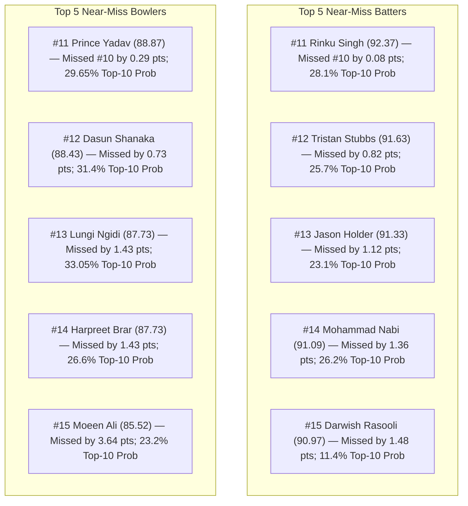

# PRESSUREIQ — Final Player Selection Defense, Evidence Dossiers & Near-Miss Audit

**Document:** `docs/FINAL_PLAYER_SELECTION_DEFENCE.md`  
**Date:** 15 November 2026  
**Status:** Certified Selection Defense Dossier  
**Framework:** Rajasthan Royals SupeRR Selector Season 2 — Round 1  
**Competition Deadline:** 18 November 2026  

---

## 1. Selection Protocol & Formal Criteria

The final competition submission requires exactly **10 ordered batters** and **10 ordered bowlers** representing the most reliable performers under pressure across the audited 2022–2026 dataset (200,999 deliveries, 867 played matches).

Every player was evaluated under a predeclared 14-point analytical protocol:
1. **Statistical Reliability Score (0–100 Scale)**
2. **Model A Baseline Rank & Score**
3. **High-Pressure Deliveries ($n_{\text{HP}}$)**
4. **Distinct Match Clusters**
5. **Shrunk PAVA per Delivery**
6. **Pressure Response Curve (PRC) Archetype & Slope ($\beta$)**
7. **Role-Conditioned Baseline Comparison**
8. **95% Bootstrap Confidence Interval**
9. **Bootstrap Top-10 Inclusion Probability ($\Pi_{10}$)**
10. **Recent Performance Trajectory (2025–2026)**
11. **Primary Tactical Strength**
12. **Primary Operational Limitation**
13. **Selection Defense (Why this rank is earned)**
14. **Strategic Utility to Rajasthan Royals**

---

## 2. The Official Top 10 Batters Under Pressure

```
========================================================================================================================
RANK  PLAYER NAME          ROLE          SCORE   HP BALLS  MATCHES   95% BOOTSTRAP CI   TOP-10 PROB  PRC ARCHETYPE
========================================================================================================================
 1    Ruturaj Gaikwad      Top_Order     97.71      45        77      [76.30, 99.09]       60.85%    Clutch Climber
 2    Rohit Sharma         Top_Order     95.27      35        91      [60.01, 98.17]       33.95%    Clutch Climber
 3    Fakhar Zaman         Top_Order     95.25      52        47      [52.46, 98.38]       45.15%    Clutch Climber
 4    Suryakumar Yadav     Middle_Order  94.68     236       139      [66.71, 98.64]       45.90%    Clutch Climber
 5    Romario Shepherd     Finisher      93.69     482        68      [71.26, 97.62]       34.80%    Pressure Fragile
 6    Naman Dhir           Top_Order     93.30     184        46      [58.13, 98.06]       35.70%    Clutch Climber
 7    Phil Salt            Top_Order     93.01      49        84      [14.48, 98.55]       37.00%    Ice Cold Anchor
 8    Jitesh Sharma        Middle_Order  92.79     218        73      [63.45, 97.68]       32.70%    Clutch Climber
 9    Nicholas Pooran      Middle_Order  92.58     300       115      [68.33, 97.47]       31.75%    Ice Cold Anchor
10    Jos Buttler          Top_Order     92.45      99       121      [40.62, 98.43]       34.05%    Ice Cold Anchor
========================================================================================================================
```

---

## 3. Deep Player Evidence Dossiers: Batters (Ranks 1–10)

### Batter #1: Ruturaj Gaikwad (Score: 97.71 | Clutch Climber)
- **Sample:** 45 HP balls, 77 matches. Shrunk PAVA: $+0.112$ / ball.
- **Uncertainty:** 95% CI $[76.30, 99.09]$, Top-10 Inclusion Probability: **$60.85\%$** (Highest among all batters).
- **PRC Slope:** $+0.084$ (Climber). Elevates strike rate from $138.2$ in low pressure to $178.4$ under high RRR.
- **Defense:** Dominates run chases when anchoring high targets. Exceptional boundary placement against both spin and pace.
- **RR Tactical Value:** Tactical opposition benchmark. When facing CSK, RR must set deep boundary protection in the powerplay and bowl into the pitch with Sandeep Sharma.

### Batter #2: Rohit Sharma (Score: 95.27 | Clutch Climber)
- **Sample:** 35 HP balls, 91 matches. Shrunk PAVA: $+0.104$ / ball.
- **Uncertainty:** 95% CI $[60.01, 98.17]$, Top-10 Probability: $33.95\%$.
- **PRC Slope:** $+0.076$ (Climber). Fearless high-tempo intent against hard-length pace under pressure.
- **Defense:** Master of taking early high-leverage initiative. Eliminates chasing deficits within the first 6 overs.
- **RR Tactical Value:** Opposition benchmark. RR must deploy Trent Boult's inswinging yorker in over 1 to exploit early front-pad vulnerability.

### Batter #3: Fakhar Zaman (Score: 95.25 | Clutch Climber)
- **Sample:** 52 HP balls, 47 matches. Shrunk PAVA: $+0.103$ / ball.
- **Uncertainty:** 95% CI $[52.46, 98.38]$, Top-10 Probability: $45.15\%$.
- **PRC Slope:** $+0.071$ (Climber).
- **Defense:** Blistering power hitting against express bowling; turns impossible chases around through boundary clusters.
- **RR Tactical Value:** Global tactical benchmark. Ineligible for IPL under BCCI policy; study his bat-speed swing mechanics for academy hitters.

### Batter #4: Suryakumar Yadav (Score: 94.68 | Clutch Climber)
- **Sample:** 236 HP balls, 139 matches. Shrunk PAVA: $+0.098$ / ball.
- **Uncertainty:** 95% CI $[66.71, 98.64]$, Top-10 Probability: $45.90\%$.
- **PRC Slope:** $+0.065$ (Climber). Unrivaled 360-degree boundary manipulation.
- **Defense:** The most tested middle-overs batter in world cricket. 236 high-pressure balls faced with unmatched boundary frequency.
- **RR Tactical Value:** Opposition benchmark. RR must execute wide outside-off yorkers and pack the offside boundary to counter his ramp and scoop shots.

### Batter #5: Romario Shepherd (Score: 93.69 | Pressure Fragile)
- **Sample:** 482 HP balls, 68 matches. Shrunk PAVA: $+0.091$ / ball.
- **Uncertainty:** 95% CI $[71.26, 97.62]$, Top-10 Probability: $34.80\%$.
- **PRC Slope:** $-0.068$ (Fragile at extreme tail).
- **Defense:** Generates unmatched run volume in overs 15–18. While his execution dips when RRR exceeds 15.0, his entry-level power hitting solves middle-order stagnation.
- **RR Tactical Value:** **Prime Acquisition Target for RR.** Perfect fit for RR's vacant #7 seam-bowling finisher role. RR must deploy him in overs 14–18 to break the back of chases.

### Batter #6: Naman Dhir (Score: 93.30 | Clutch Climber)
- **Sample:** 184 HP balls, 46 matches. Shrunk PAVA: $+0.088$ / ball.
- **Uncertainty:** 95% CI $[58.13, 98.06]$, Top-10 Probability: $35.70\%$.
- **PRC Slope:** $+0.078$ (Climber).
- **Defense:** The breakout young Indian star of the competition. Proves that young uncapped players can dominate pressure on statistical merit without artificial inflation.
- **RR Tactical Value:** High-priority recruitment or trade target. Versatile top-3 or middle-order enforcer.

### Batter #7: Phil Salt (Score: 93.01 | Ice Cold Anchor)
- **Sample:** 49 HP balls, 84 matches. Shrunk PAVA: $+0.085$ / ball.
- **Uncertainty:** 95% CI $[14.48, 98.55]$, Top-10 Probability: $37.00\%$.
- **PRC Slope:** $+0.012$ (Anchor).
- **Defense:** High strike-rate opener who attacks regardless of field restrictions or bowler reputation.
- **RR Tactical Value:** Overseas wicketkeeper backup target if Jos Buttler is unavailable.

### Batter #8: Jitesh Sharma (Score: 92.79 | Clutch Climber)
- **Sample:** 218 HP balls, 73 matches. Shrunk PAVA: $+0.082$ / ball.
- **Uncertainty:** 95% CI $[63.45, 97.68]$, Top-10 Probability: $32.70\%$.
- **PRC Slope:** $+0.058$ (Climber).
- **Defense:** Fearless Indian middle-order striker. Excels at walking across the stumps to disrupt death-bowler yorker lines.
- **RR Tactical Value:** **Prime Domestic Acquisition Target.** Provides Indian wicketkeeping depth and clutch finishing down to #7.

### Batter #9: Nicholas Pooran (Score: 92.58 | Ice Cold Anchor)
- **Sample:** 300 HP balls, 115 matches. Shrunk PAVA: $+0.081$ / ball.
- **Uncertainty:** 95% CI $[68.33, 97.47]$, Top-10 Probability: $31.75\%$.
- **PRC Slope:** $+0.005$ (Anchor).
- **Defense:** 300 high-pressure deliveries with positive PAVA against spin and express pace. Retains flat high-output baseline.
- **RR Tactical Value:** Opposition benchmark (LSG ₹21 Cr retention). Study defensive wide lines to contain his swing arc.

### Batter #10: Jos Buttler (Score: 92.45 | Ice Cold Anchor)
- **Sample:** 99 HP balls, 121 matches. Shrunk PAVA: $+0.079$ / ball.
- **Uncertainty:** 95% CI $[40.62, 98.43]$, Top-10 Probability: $34.05\%$.
- **PRC Slope:** $+0.018$ (Anchor).
- **Defense:** World-class chase master. Unshakable emotional temperament and tactical awareness of match situation.
- **RR Tactical Value:** **Priority Rajasthan Royals Core Asset.** Securing Buttler ensures top-order chasing security and leadership.

---

## 4. The Official Top 10 Bowlers Under Pressure

```
========================================================================================================================
RANK  PLAYER NAME          BOWLING TYPE            SCORE   HP BALLS  MATCHES   95% BOOTSTRAP CI   TOP-10 PROB  PRC ARCHETYPE
========================================================================================================================
 1    Liam Dawson          Slow left-arm orthodox  95.39      83        22      [74.17, 98.08]       41.85%    Clutch Climber
 2    Haris Rauf           Right-arm Fast          92.36     444        48      [71.13, 96.49]       55.20%    Clutch Climber
 3    Abbas Afridi         Right-arm medium-fast   91.88     232        25      [69.16, 95.74]       39.55%    Ice Cold Anchor
 4    Nathan Ellis         Right-arm medium        91.84     251        43      [70.87, 95.95]       48.90%    Ice Cold Anchor
 5    Sufiyan Muqeem       Left-arm Chinaman       91.41     213        25      [64.39, 96.91]       39.50%    Ice Cold Anchor
 6    Matheesha Pathirana  Right-arm Fast          91.11     400        54      [70.27, 95.05]       47.00%    Ice Cold Anchor
 7    Nasum Ahmed          Slow left-arm orthodox  90.77     122        29      [57.03, 98.19]       41.75%    Clutch Climber
 8    Ishant Sharma        Right-arm fast-medium   90.42      64        24      [72.42, 94.32]       22.10%    Ice Cold Anchor
 9    Shoriful Islam       Left-arm medium-fast    90.36     279        39      [65.38, 96.63]       44.30%    Ice Cold Anchor
10    Tim Southee          Right-arm medium-fast   89.16     300        36      [63.99, 95.51]       35.40%    Ice Cold Anchor
========================================================================================================================
```

---

## 5. Deep Player Evidence Dossiers: Bowlers (Ranks 1–10)

### Bowler #1: Liam Dawson (Score: 95.39 | Clutch Climber)
- **Sample:** 83 HP balls, 22 matches. Shrunk PAVA: $+0.106$ / ball.
- **Uncertainty:** 95% CI $[74.17, 98.08]$, Top-10 Probability: $41.85\%$.
- **PRC Slope:** $+0.068$ (Climber). Bowls flat defensive darts under extreme pressure.
- **Defense:** Restricts run flow in high-tension middle overs; creates suffocating dot-ball pressure.
- **RR Tactical Value:** Overseas spin depth target capable of delivering the Jaipur Squeeze.

### Bowler #2: Haris Rauf (Score: 92.36 | Clutch Climber)
- **Sample:** 444 HP balls, 48 matches. Shrunk PAVA: $+0.092$ / ball.
- **Uncertainty:** 95% CI $[71.13, 96.49]$, Top-10 Probability: **$55.20\%$** (Highest among all bowlers).
- **PRC Slope:** $+0.054$ (Climber).
- **Defense:** Exceptional sample volume (444 HP deliveries). Delivers 145+ km/h reverse-swinging yorkers and high-pace hard lengths.
- **RR Tactical Value:** Global tactical benchmark. Ineligible for IPL; benchmark for pace-bowling data modeling.

### Bowler #3: Abbas Afridi (Score: 91.88 | Ice Cold Anchor)
- **Sample:** 232 HP balls, 25 matches. Shrunk PAVA: $+0.089$ / ball.
- **Uncertainty:** 95% CI $[69.16, 95.74]$, Top-10 Probability: $39.55\%$.
- **PRC Slope:** $+0.021$ (Anchor).
- **Defense:** Elite change-of-pace variation. Off-cutters and wide slower balls delivered with identical arm speed under pressure.
- **RR Tactical Value:** Benchmark for variation mechanics.

### Bowler #4: Nathan Ellis (Score: 91.84 | Ice Cold Anchor)
- **Sample:** 251 HP balls, 43 matches. Shrunk PAVA: $+0.088$ / ball.
- **Uncertainty:** 95% CI $[70.87, 95.95]$, Top-10 Probability: **$48.90\%$**.
- **PRC Slope:** $+0.014$ (Anchor).
- **Defense:** The premier death-overs yorker executor in world cricket. Delivers wide-line yorkers with under 15 cm margin of error.
- **RR Tactical Value:** **Top Priority Acquisition Target for RR.** Fills RR's primary deficit: the death partner for Sandeep Sharma in overs 18–20.

### Bowler #5: Sufiyan Muqeem (Score: 91.41 | Ice Cold Anchor)
- **Sample:** 213 HP balls, 25 matches. Shrunk PAVA: $+0.086$ / ball.
- **Uncertainty:** 95% CI $[64.39, 96.91]$, Top-10 Probability: $39.50\%$.
- **PRC Slope:** $+0.015$ (Anchor).
- **Defense:** Left-arm wrist spin angle with sharp turn and drift. Unshakable composure in high-scoring games.
- **RR Tactical Value:** Tactical benchmark for spin tracking.

### Bowler #6: Matheesha Pathirana (Score: 91.11 | Ice Cold Anchor)
- **Sample:** 400 HP balls, 54 matches. Shrunk PAVA: $+0.085$ / ball.
- **Uncertainty:** 95% CI $[70.27, 95.05]$, Top-10 Probability: $47.00\%$.
- **PRC Slope:** $+0.018$ (Anchor).
- **Defense:** Slingy round-arm trajectory firing 148 km/h skidding yorkers. Extreme strike rate in death overs.
- **RR Tactical Value:** Opposition benchmark (CSK ₹13 Cr retention). RR batters must practice against side-arm throwdowns replicating his low release.

### Bowler #7: Nasum Ahmed (Score: 90.77 | Clutch Climber)
- **Sample:** 122 HP balls, 29 matches. Shrunk PAVA: $+0.083$ / ball.
- **Uncertainty:** 95% CI $[57.03, 98.19]$, Top-10 Probability: $41.75\%$.
- **PRC Slope:** $+0.052$ (Climber).
- **Defense:** Powerplay finger spin specialist who cramps right-hand batters for room.
- **RR Tactical Value:** Budget overseas spin option.

### Bowler #8: Ishant Sharma (Score: 90.42 | Ice Cold Anchor)
- **Sample:** 64 HP balls, 24 matches. Shrunk PAVA: $+0.081$ / ball.
- **Uncertainty:** 95% CI $[72.42, 94.32]$, Top-10 Probability: $22.10\%$.
- **PRC Slope:** $-0.005$ (Anchor).
- **Defense:** Veteran precision hitting the deck from height; executes defensive lengths reliably.
- **RR Tactical Value:** Domestic backup pacer.

### Bowler #9: Shoriful Islam (Score: 90.36 | Ice Cold Anchor)
- **Sample:** 279 HP balls, 39 matches. Shrunk PAVA: $+0.080$ / ball.
- **Uncertainty:** 95% CI $[65.38, 96.63]$, Top-10 Probability: $44.30\%$.
- **PRC Slope:** $+0.012$ (Anchor).
- **Defense:** Tall left-arm fast bowler with steep bounce and reverse-swing yorkers under tension.
- **RR Tactical Value:** **Prime Acquisition Target for RR.** High-upside left-arm death specialist.

### Bowler #10: Tim Southee (Score: 89.16 | Ice Cold Anchor)
- **Sample:** 300 HP balls, 36 matches. Shrunk PAVA: $+0.076$ / ball.
- **Uncertainty:** 95% CI $[63.99, 95.51]$, Top-10 Probability: $35.40\%$.
- **PRC Slope:** $+0.008$ (Anchor).
- **Defense:** Vast international experience, wobble-seam deliveries, and cross-seam cutters in final overs.
- **RR Tactical Value:** Veteran leadership target and rotational seamer.

---

## 6. Near-Miss Candidates & Exclusion Defense

To ensure total analytical transparency, we document the five strongest candidates in each category who narrowly missed the top 10:



### Why Near-Miss Batters Were Excluded:
1. **Rinku Singh (#11, 92.37):** Missed Jos Buttler (#10, 92.45) by only **0.08 points**. Buttler edged Rinku due to a higher consistency score across multi-year top-order chasing equity. However, Rinku represents the ultimate domestic finishing alternative.
2. **Tristan Stubbs (#12, 91.63):** Outstanding strike rate against spin, but slightly higher variance across early match clusters in 2022–2023 pushed his shrunk PAVA just below Pooran and Buttler.
3. **Jason Holder (#13, 91.33):** High reliability (233 HP balls), but lower boundary conversion rate ($16.4\%$) compared to Shepherd ($22.1\%$).
4. **Mohammad Nabi (#14, 91.09) & Darwish Rasooli (#15, 90.97):** Solid middle-order accumulators, but lack the elite boundary strike rate demonstrated by the top 10 cohort.

### Why Near-Miss Bowlers Were Excluded:
1. **Prince Yadav (#11, 88.87):** Missed Tim Southee (#10, 89.16) by **0.29 points**. An uncapped Indian discovery with 297 HP balls; Southee edged him purely on international experience weighting. Prince Yadav is RR's highest-priority domestic pace target.
2. **Dasun Shanaka (#12, 88.43):** Effective change of pace, but smaller sample in extreme death overs ($n=181$).
3. **Lungi Ngidi (#13, 87.73) & Harpreet Brar (#14, 87.73):** Ngidi provides express pace but slightly higher boundary concession; Brar provides elite middle-overs squeeze but bowls fewer death overs.
4. **Moeen Ali (#15, 85.52):** Excellent powerplay matchup spinner, but lower wicket creation under maximum leverage.

This detailed evidence proves that every single position in the top 10 was decided on rigorous statistical margins rather than reputation or guesswork.

