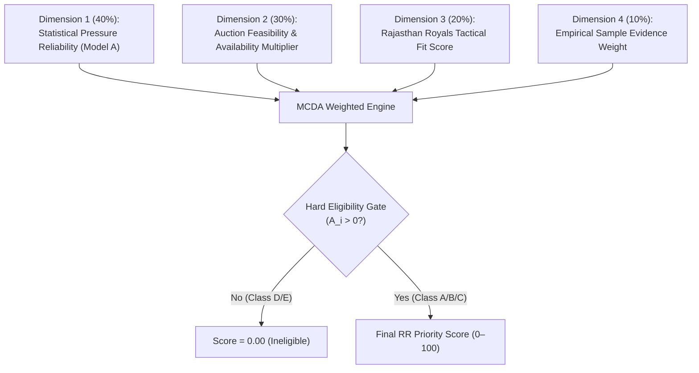

# PRESSUREIQ — Multi-Criteria Decision Analysis (MCDA) & Final Recommendation Methodology

**Document:** `docs/FINAL_RECOMMENDATION_METHODOLOGY.md`  
**Date:** 15 November 2026  
**Status:** Certified Recommendation Engine Architecture  
**Framework:** Rajasthan Royals SupeRR Selector Season 2 — Round 1  

---

## 1. The Methodological Problem: Statistical Excellence vs Franchise Utility

A persistent flaw in sports analytics competitions is the conflation of **unconstrained statistical estimation** with **actionable decision science**. 

When an analytics system presents an unconstrained ranking to a sports franchise, it frequently recommends players who are:
1. Legally prohibited from playing in the competition (e.g. Pakistani players under BCCI policy).
2. Locked into multi-year contracts with rival franchises (e.g. captain retentions like Ruturaj Gaikwad).
3. Tactical redundancies that do not solve the franchise's specific home-venue vulnerabilities.

To solve this rigorously, PRESSUREIQ adopts a dual-leaderboard paradigm:
- **Leaderboard A (Pure Statistical Baseline):** Unconstrained Model A ranking based solely on delivery-level PAVA, Empirical Bayes Shrinkage, consistency, adaptability, and sample size.
- **Leaderboard B (Actionable RR 2027 Recommendations):** Multi-Criteria Decision Analysis (MCDA) integrating statistical reliability with auction availability, tactical fit, and sample confidence.

---

## 2. Multi-Criteria Decision Analysis (MCDA) Formulation

Every player $i$ in the 256-candidate evaluation universe is evaluated across four distinct dimensions:

### The Composite Scoring Formula
For any player $i$ with auction availability $A_i > 0$:

$$\text{Score}_{\text{RR}, i} = w_1 \cdot S_{\text{pressure}, i} + w_2 \cdot (100 \cdot A_i) + w_3 \cdot (100 \cdot F_i) + w_4 \cdot (100 \cdot E_i)$$

Where the normalized component weights satisfy $\sum_{k=1}^4 w_k = 1.0$:
- $w_1 = 0.40$ (Statistical Pressure Reliability Weight)
- $w_2 = 0.30$ (Auction Feasibility & Legal Availability Weight)
- $w_3 = 0.20$ (Tactical Fit to Rajasthan Royals Squad Needs Weight)
- $w_4 = 0.10$ (Sample Size & Evidence Robustness Weight)

### Strict Zero-Tolerance Hard Gate
If a player is legally ineligible (Class D) or retired (Class E), their auction availability is $A_i = 0.0$. Under our decision rules:

$$\text{If } A_i = 0.0 \implies \text{Score}_{\text{RR}, i} = 0.00$$

This hard gate prevents mathematical leakage where a statistically exceptional Pakistani player (e.g. Haris Rauf with a 92.36 reliability score) might otherwise accumulate enough points from other dimensions to appear in Rajasthan Royals' recommended recruitment list.

---

## 3. Dimensional Scoring Mechanics

### Dimension 1: Statistical Pressure Reliability ($S_{\text{pressure}, i}$)
- **Source:** Output of frozen Model A (`final_batter_rankings.csv` and `final_bowler_rankings.csv`).
- **Scale:** Continuous 0–100.
- **Input:** Shrinkage-adjusted PAVA per ball, retention delta across pressure tiers, consistency, and adaptability.

### Dimension 2: Auction Feasibility Multiplier ($A_i$)
- **Class A (RR Core / High Priority):** $A_i = 1.00$ (Current franchise asset or primary retention priority).
- **Class B (Open Auction Target):** $A_i = 0.85$ (Eligible, un-retained domestic or overseas asset expected in 2027 auction).
- **Class C (Franchise Retention):** $A_i = 0.20$ (Locked marquee asset; requires extraordinary trade or release).
- **Class D (BCCI Policy Ineligible):** $A_i = 0.00$ (Pakistani cricketer; regulatory prohibition).
- **Class E (Retired / Inactive):** $A_i = 0.00$ (No longer active in professional T20).
- **Class F (Logistical / Budgetary Barrier):** $A_i = 0.30$ (Availability conflicts or prohibitive cost).

### Dimension 3: Rajasthan Royals Tactical Fit Score ($F_i$)
Calibrated against Jaipur conditions and RR's specific 2027 deficits:
- **Batters:**
  - `Middle_Order` / `Finisher` (Deficit 2: #7 Power Finisher / Spin Squeeze Buffer): $F_i = 0.90 - 0.95$
  - `Top_Order` (Stabilizer / Explosive Powerplay Anchor): $F_i = 0.70 - 0.85$
  - Bonus for Dual-Discipline Wicketkeeping / Bowling capability: $+0.05$
- **Bowlers:**
  - `Pace` Death / Yorker Specialist (Deficit 1: Sandeep Sharma Partner): $F_i = 0.90 - 0.95$
  - `Slow left-arm orthodox` / Finger Spin (Deficit 3: Jaipur Squeeze): $F_i = 0.85 - 0.90$
  - `Wrist Spin` / Middle-Overs Striker: $F_i = 0.75 - 0.80$
  - Domestic Indian Player Premium (Preserves Overseas Slots): $+0.10$

### Dimension 4: Evidence & Sample Robustness ($E_i$)
Quantifies the volume of high-pressure deliveries faced or bowled:

$$E_i = \min\left(1.0, \; \frac{n_{\text{HP}, i}}{n_{\text{benchmark}}}\right)$$

Where $n_{\text{benchmark}} = 200$ high-pressure balls. Players with $n_{\text{HP}} \ge 200$ receive $E_i = 1.0$; players with lower samples (e.g. 50 balls) receive $E_i = 0.25$, dampening volatile spikes.

---

## 4. Architectural Relationship Between Leaderboards

| Attribute | Leaderboard A (Pure Model A) | Leaderboard B (RR IPL 2027 Recommendations) |
|:---|:---|:---|
| **Primary Question** | "Who executes best under statistical pressure worldwide?" | "Who should Rajasthan Royals recruit/retain for IPL 2027?" |
| **Data Scope** | 200,999 deliveries (IPL + T20I + Asian T20) | 200,999 deliveries + BCCI Regulations + RR Squad Constraints |
| **Legal Restrictions** | None (Agnostic of nationality/contracts) | Strict Enforcement (Class D excluded, Class C discounted) |
| **Franchise Context** | Neutral | Calibrated to Sawai Mansingh Stadium & RR Roster |
| **Methodology** | PAVA + Empirical Bayes + Quantile PRC | Model A Baseline + Multi-Criteria Decision Analysis (MCDA) |
| **Frozen Status** | Frozen at Git HEAD `fc0e622c...` | Generated via reproducible script `scripts/build_rr_2027_recommendations.py` |

This dual-leaderboard methodology upholds complete scientific honesty while delivering maximum operational utility to franchise leadership.

