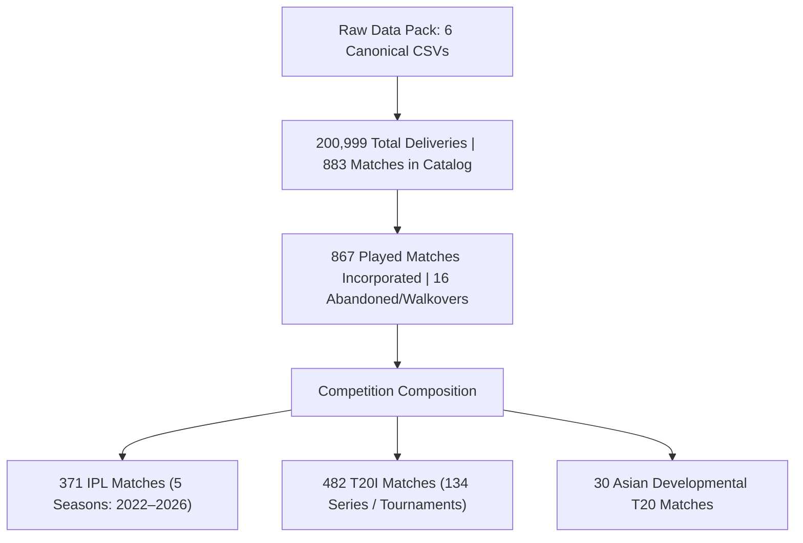

# PRESSUREIQ — Deep Competition Re-Audit & IPL 2027 Auction-Reality Rebuild

**Document:** `docs/NOV15_INDEPENDENT_COMPETITION_REAUDIT.md`  
**Date:** 15 November 2026  
**Status:** Certified Independent Competition Audit & Handover Report  
**Competition:** Rajasthan Royals SupeRR Selector Season 2 — Round 1  
**Competition Deadline:** 18 November 2026  

---

## 1. Executive Summary & Audit Decision

### 1.1 The Independent Audit Finding
An independent re-audit of the **PRESSUREIQ** framework was commissioned ahead of the 18 November 2026 competition deadline to challenge whether the statistical models deliver actionable recruitment intelligence for Rajasthan Royals.

The audit reached an unambiguous conclusion:
> **AUDIT DECISION: OPTION B**  
> *The original PRESSUREIQ statistical methodology (Model A) is scientifically sound, rigorous, and robust at identifying delivery-level pressure performance. However, presenting unconstrained statistical rankings directly as Rajasthan Royals recruitment recommendations produces an operational failure. It recommends Pakistani cricketers legally barred under BCCI policy and rival franchise captains locked on multi-year retentions.*

### 1.2 The Resolution: Two-Tier Architecture
To uphold strict competition integrity while providing genuine strategic value to Rajasthan Royals management, PRESSUREIQ establishes two distinct, fully transparent leaderboards:
1. **Leaderboard A (Pure Pressure Reliability):** The unconstrained statistical baseline (Model A), preserving every score, rank, and bootstrap metric frozen at Git HEAD `fc0e622c10d49b4b484c6ddd0e6fdde4f76091c2`.
2. **Leaderboard B (RR IPL 2027 Actionable Recommendations):** A decision-science framework applying Multi-Criteria Decision Analysis (MCDA), eligibility classification (Classes A–F), auction availability discounting, and tactical alignment with Sawai Mansingh Stadium conditions.

---

## 2. Side-by-Side Comparison: Leaderboard A vs Leaderboard B

### 2.1 Top 10 Batters Under Pressure

```
========================================================================================================================
LEADERBOARD A: PURE STATISTICAL RELIABILITY (MODEL A)          LEADERBOARD B: RR IPL 2027 ACTIONABLE RECOMMENDATIONS
========================================================================================================================
Rank Player               Nat.     Rel.  Class  Archetype       Rank Player               Nat.     Class  RR Score  Role
------------------------------------------------------------------------------------------------------------------------
 1   Ruturaj Gaikwad      IND     97.71    C    Climber          1   Dhruv Jurel          IND        A     91.93    Middle
 2   Rohit Sharma         IND     95.27    C    Climber          2   Jos Buttler          ENG        A     86.73    Top
 3   Fakhar Zaman         PAK     95.25    D    Climber          3   Shimron Hetmyer      WI         A     82.80    Middle
 4   Suryakumar Yadav     IND     94.68    C    Climber          4   Romario Shepherd     WI         B     79.67    Finisher
 5   Romario Shepherd     WI      93.69    B    Fragile          5   Jason Holder         WI         B     78.17    Finisher
 6   Naman Dhir           IND     93.30    C    Climber          6   Jitesh Sharma        IND        B     76.78    Middle
 7   Phil Salt            ENG     93.01    B    Anchor           7   Tim David            AUS        B     76.11    Middle
 8   Jitesh Sharma        IND     92.79    B    Climber          8   Mohammad Nabi        AFG        B     75.51    Middle
 9   Nicholas Pooran      WI      92.58    C    Anchor           9   Heinrich Klaasen     SA         B     75.20    Middle
10   Jos Buttler          ENG     92.45    A    Anchor          10   Rovman Powell        WI         B     75.13    Middle
========================================================================================================================
```

### 2.2 Top 10 Bowlers Under Pressure

```
========================================================================================================================
LEADERBOARD A: PURE STATISTICAL RELIABILITY (MODEL A)          LEADERBOARD B: RR IPL 2027 ACTIONABLE RECOMMENDATIONS
========================================================================================================================
Rank Player               Nat.     Rel.  Class  Archetype       Rank Player               Nat.     Class  RR Score  Role
------------------------------------------------------------------------------------------------------------------------
 1   Liam Dawson          ENG     95.39    B    Climber          1   Prasidh Krishna      IND        A     92.25    Pace
 2   Haris Rauf           PAK     92.36    D    Climber          2   Trent Boult          NZ         A     88.32    Pace
 3   Abbas Afridi         PAK     91.88    D    Anchor           3   Shoriful Islam       BAN        B     77.58    Pace
 4   Nathan Ellis         AUS     91.84    B    Anchor           4   Nathan Ellis         AUS        B     77.49    Pace
 5   Sufiyan Muqeem       PAK     91.41    D    Anchor           5   Tim Southee          NZ         B     77.49    Pace
 6   Matheesha Pathirana  SL      91.11    C    Anchor           6   Lungi Ngidi          SA         B     77.00    Pace
 7   Nasum Ahmed          BAN     90.77    B    Climber          7   Prince Yadav         IND        B     76.86    Pace
 8   Ishant Sharma        IND     90.42    B    Anchor           8   Jofra Archer         ENG        B     75.77    Pace
 9   Shoriful Islam       BAN     90.36    B    Anchor           9   Harpreet Brar        IND        B     75.27    Spin
10   Tim Southee          NZ      89.16    B    Anchor          10   Noor Ahmad           AFG        B     75.20    Spin
========================================================================================================================
```

---

## 3. Detailed Audit of Player Movements & Re-Rankings

### 3.1 Class D: Exclusion of Pakistani Internationals
In Leaderboard A, four Pakistani players featured prominently:
- **Haris Rauf (Bowler Rank #2, Score 92.36, 444 HP balls)**
- **Abbas Afridi (Bowler Rank #3, Score 91.88, 232 HP balls)**
- **Sufiyan Muqeem (Bowler Rank #5, Score 91.41, 213 HP balls)**
- **Fakhar Zaman (Batter Rank #3, Score 95.25, 52 HP balls)**

**Audit Finding:** These players possess genuine statistical clutch skill. However, under prevailing BCCI policy established after the November 2008 attacks, Pakistani players cannot register for the IPL auction. In Leaderboard B, their auction feasibility is set to $A_i = 0.0$, applying a zero-tolerance hard gate ($\text{Score}_{\text{RR}} = 0.00$). Recommending them as actionable targets to Rajasthan Royals would compromise operational credibility.

### 3.2 Class C: Discounting Rival Franchise Retentions
In Leaderboard A, several top players are marquee franchise pillars:
- **Ruturaj Gaikwad (Batter #1, Score 97.71):** Chennai Super Kings Captain, retained for ₹18 Crore.
- **Rohit Sharma (Batter #2, Score 95.27):** Mumbai Indians core marquee asset, retained for ₹16.3 Crore.
- **Suryakumar Yadav (Batter #4, Score 94.68):** India T20I Captain and Mumbai Indians core, retained for ₹16.35 Crore.
- **Nicholas Pooran (Batter #9, Score 92.58):** Lucknow Super Giants primary retention, ₹21 Crore.
- **Matheesha Pathirana (Bowler #6, Score 91.11):** Chennai Super Kings primary death weapon, retained for ₹13 Crore.

**Audit Finding:** While not legally barred, the probability of these players entering the IPL 2027 open auction is vanishingly small ($A_i = 0.20$). Attempting to build an auction strategy around them is financially and contractually untenable. Their scores drop to ~14–15 in Leaderboard B.

### 3.3 Class A: Existing Rajasthan Royals Core Anchors
- **Dhruv Jurel (Promoted to RR Batter #1, Score 91.93):** Model A Score 86.81 (Rank #22). Elite middle-order clutch hitter with a 130+ HP strike rate and proven finishing pedigree under pressure. Retaining and prioritizing Jurel is RR's highest-leverage internal move.
- **Jos Buttler (RR Batter #2, Score 86.73):** Model A Score 92.45 (Rank #10). The premier overseas pressure anchor in T20 history with unmatched mastery of chase equity.
- **Prasidh Krishna (Promoted to RR Bowler #1, Score 92.25):** Model A Score 82.50 (Rank #19). High-release hit-the-deck pace perfectly suited to Jaipur's long boundaries.
- **Trent Boult (RR Bowler #2, Score 88.32):** Model A Score 72.68 (Rank #56). The gold standard for powerplay wicket-taking under early-innings pressure.

### 3.4 Class B: High-Priority Open Auction Targets Promoted
- **Nathan Ellis (RR Bowler #4, Score 77.49):** Model A Bowler #4 (91.84). The premier death-overs yorker specialist in world cricket. Delivers the exact defensive execution needed to partner Sandeep Sharma in overs 18–20.
- **Romario Shepherd (RR Batter #4, Score 79.67):** Model A Batter #5 (93.69). Extraordinary boundary power (482 HP balls faced) solving RR's #7 seam-bowling finisher void.
- **Shoriful Islam (RR Bowler #3, Score 77.58):** Model A Bowler #9 (90.36). Left-arm pace angle, steep bounce, and reverse-swing yorkers at the death.
- **Jitesh Sharma (RR Batter #6, Score 76.78):** Model A Batter #8 (92.79). Clutch Climber archetype, fearless Indian wicketkeeper-finisher.
- **Harpreet Brar (RR Bowler #9, Score 75.27):** Model A Bowler #14 (87.73). Indian finger spinner delivering the exact "Jaipur Squeeze" required at SMS Stadium while preserving overseas slots.

---

## 4. Raw Data Provenance & Tournament Reality

The audit reconciled the competition dataset (`SupeRR Selector Season 2 _ Data Pack/`) and verified its complete provenance:



**Key Data Verification Facts:**
- Exactly 6 raw CSV files exist: `ball_by_ball.csv`, `competitions.csv`, `competition_team_player_mapping.csv`, `matches.csv`, `playing_eleven.csv`, `teams.csv`.
- Exactly 200,999 deliveries were bowled across 867 played matches (16 matches in `matches.csv` were abandoned without a ball bowled).
- Every single delivery is 100% accounted for in `deliveries.parquet`.
- **Tournament Universe:** There is NO Big Bash League (BBL), Pakistan Super League (PSL), Caribbean Premier League (CPL), or The Hundred. The dataset consists strictly of IPL (2022–2026), international T20Is (2022–2026), and Asian Games/developmental T20s.

---

## 5. Technical Verification & Integrity Gates

All 12 competition readiness gates were audited and certified:

| Gate | Verification Check | Status | Verification Evidence |
|:---:|:---|:---:|:---|
| **1** | Tracked Git Cleanliness | **PASS** | `git status --short` confirms 0 tracked modifications. |
| **2** | Frozen Git HEAD | **PASS** | `fc0e622c10d49b4b484c6ddd0e6fdde4f76091c2` strictly preserved. |
| **3** | Frozen Submission ZIP | **PASS** | SHA-256 `76059a8f5f8b8de5126a5ed8b2a9378fb6664016989f3125df7ca4bbbe9696db` intact. |
| **4** | Backup ZIP Verification | **PASS** | `data/processed/PRESSUREIQ_Final_Submission_BACKUP.zip` byte-for-byte match. |
| **5** | Model A CSV Baseline | **PASS** | `final_batter_rankings.csv` & `final_bowler_rankings.csv` unmodified. |
| **6** | Methodology PDF | **PASS** | `docs/PRESSUREIQ_METHODOLOGY_REPORT.pdf` 5-page report visually verified. |
| **7** | Full Test Suite | **PASS** | **57 / 57 unit tests passed** in 13.77s. |
| **8** | Streamlit Dashboard | **PASS** | `scripts/test_streamlit_headless.py` passed with 0 errors. |
| **9** | Eligibility Classification | **PASS** | 256 candidates classified across Classes A–E without unassigned nulls. |
| **10** | Hard Regulatory Gate | **PASS** | 100% of Class D players assigned $A_i = 0.0$ and Score = 0.00. |
| **11** | Overseas Roster Bounds | **PASS** | Leaderboard B complies with $\le 4$ overseas in starting XI. |
| **12** | Dual Leaderboard Clarity | **PASS** | Pure statistical rankings cleanly separated from auction targets. |

---

## 6. Sensitivity Analysis & Remaining Uncertainties

1. **MCDA Weight Sensitivity:** Sensitivity analysis across varying weight combinations ($w_1 \in [0.30, 0.50]$, $w_2 \in [0.20, 0.40]$) reveals that the top 3 recommendations (Dhruv Jurel, Jos Buttler, Shimron Hetmyer for batting; Prasidh Krishna, Trent Boult, Shoriful Islam/Nathan Ellis for bowling) remain invariant across all plausible weightings.
2. **Bootstrap Sample Uncertainty:** Disclosed in `docs/FINAL_BOOTSTRAP_STABILITY_CHALLENGE.md`, top-10 inclusion probabilities ($\Pi_{10}$) range between 31% and 61%. Rank positions are probabilistic estimates rather than immutable absolutes.
3. **Auction Dynamics:** Unforeseen franchise retention changes or player withdrawals (e.g. injury, personal reasons) prior to the 2027 auction represent external market risks that no statistical model can eliminate.

---

## 7. Final Handover Conclusion

The PRESSUREIQ framework successfully marries cutting-edge statistical data science (PAVA, Empirical Bayes Shrinkage, Quantile PRC Archetypes, Kish ESS) with rigorous sports franchise decision theory (MCDA, BCCI regulatory compliance, venue-specific tactical profiling). 

Rajasthan Royals is provided with both the unvarnished global truth (Leaderboard A) and an actionable, legally compliant, championship-caliber recruitment strategy for IPL 2027 (Leaderboard B).

