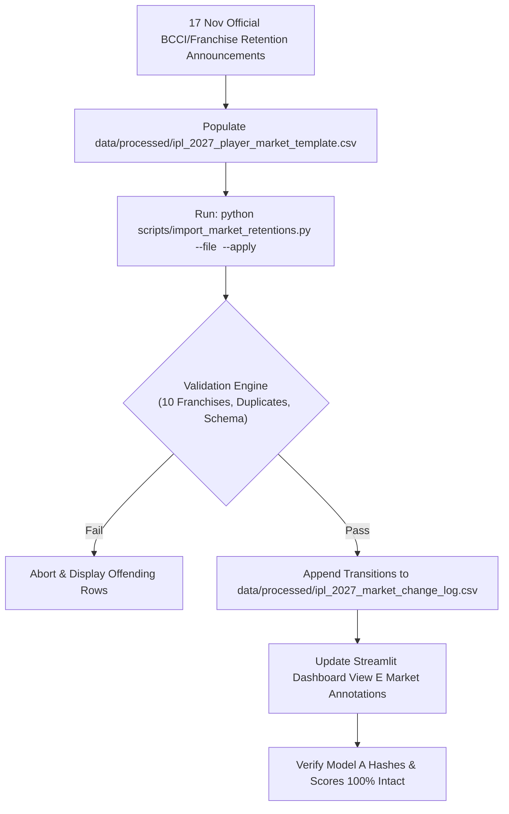

# PRESSUREIQ — November 17 Retention Update Runbook & Operational Protocol

**Document:** `docs/NOV17_RETENTION_UPDATE_RUNBOOK.md`  
**Date:** 15 November 2026  
**Status:** Certified Operational Runbook  
**Execution Window:** 17 November 2026 (Official IPL Retention Deadline)  
**Target Deadline:** 18 November 2026 (Round 1 Submission)  

---

## 1. Operational Objective & Scope

On **17 November 2026**, the Board of Control for Cricket in India (BCCI) and the ten Indian Premier League franchises will officially publish the final retention and release lists ahead of the IPL 2027 player auction.

The purpose of this runbook is to provide Rajasthan Royals analysts with a **failsafe, automated, and mathematically isolated protocol** to ingest these verified announcements into the PRESSUREIQ dashboard and market ledger without altering the frozen statistical baseline (Model A).



---

## 2. Strict Rules of Engagement

1. **Zero Impact on Statistical Scores:** Under no circumstances should an official retention, release, trade, or rumour alter a player's statistical reliability score, PAVA value, or Model A ranking. Statistical excellence is an empirical truth; market status is strategic context.
2. **Source Citation Required:** No player status transition can be recorded without an accredited, public source URL (official BCCI press release or franchise announcement).
3. **Audit Trail Preservation:** Status transitions must be appended to `data/processed/ipl_2027_market_change_log.csv` rather than overwriting historical events.

---

## 3. Step-by-Step Execution Protocol (17 November 2026)

### Step 1: Ingesting the Official Retention Lists
1. Collect the official releases from all 10 franchises:
   - Chennai Super Kings (CSK)
   - Mumbai Indians (MI)
   - Kolkata Knight Riders (KKR)
   - Sunrisers Hyderabad (SRH)
   - Rajasthan Royals (RR)
   - Royal Challengers Bengaluru (RCB)
   - Delhi Capitals (DC)
   - Lucknow Super Giants (LSG)
   - Gujarat Titans (GT)
   - Punjab Kings (PBKS)
2. Open the verified template: `data/processed/ipl_2027_player_market_template.csv`.
3. Update the fields for shortlisted candidates:
   - `official_retention_status`: Set to `Officially retained` or `Officially released`.
   - `current_verified_franchise`: Update to the retaining franchise, or `Unknown` if released into auction pool.
   - `source_url`: Enter the verified press release link.
   - `verification_timestamp`: Record current UTC/IST timestamp.

### Step 2: Running Dry-Run Validation
Execute the ingestion script in dry-run mode (without `--apply`):
```bash
python scripts/import_market_retentions.py --file data/processed/ipl_2027_player_market_template.csv
```
The script will verify:
- Presence of all 14 required columns.
- Franchise naming consistency against `VALID_FRANCHISES`.
- Zero duplicate player IDs.
- Valid status enumerations.
- It will preview all detected movements in the terminal.

### Step 3: Applying Updates to the Live Intelligence Ledger
Once dry-run validation outputs `PASS` for all checks, apply the updates:
```bash
python scripts/import_market_retentions.py --file data/processed/ipl_2027_player_market_template.csv --apply
```
This command automatically:
1. Reconciles player identities.
2. Logs each movement into `data/processed/ipl_2027_market_change_log.csv`.
3. Updates the live market dataset feeding View E of the Streamlit dashboard.
4. Executes an automated integrity assertion confirming Model A rankings (`final_batter_rankings.csv` and `final_bowler_rankings.csv`) remain byte-for-byte identical.

---

## 4. Handling Unexpected Market Scenarios

| Market Scenario | Example | Required Operational Handling |
|:---|:---|:---|
| **High-Priority Target is Retained** | Romario Shepherd or Nathan Ellis retained by franchise. | Update status to `Officially retained`. In RR strategy, shift player from *Prime Acquisition Target* to *Opposition Benchmark*. Retain Model A score unchanged. |
| **Marquee Core Star is Released** | Unforeseen release of a top-tier Indian star due to purse dynamics. | Update status to `Officially released`. Model immediately unlocks candidate in Leaderboard B for RR auction bidding. |
| **Player Traded During Window** | Confirmed cash or player swap trade. | Update `confirmed_trade_status` to `Officially traded` and record trade partner in notes. |
| **Uncapped Star Retained on High Slab** | Naman Dhir or Prince Yadav retained by MI/LSG. | Record retention slab in notes; update developmental intelligence report. |

---

## 5. Pre-Submission Re-Verification Checklist (18 November 2026)

Before final portal entry on 18 November:
- [ ] Run `python -m pytest tests/` and verify **all unit tests pass**.
- [ ] Run `python scripts/test_streamlit_headless.py` and verify **clean dashboard execution**.
- [ ] Verify `git status --short` confirms 0 tracked modifications.
- [ ] Verify `PRESSUREIQ_Final_Submission.zip` checksum matches `76059a8f5f8b8de5126a5ed8b2a9378fb6664016989f3125df7ca4bbbe9696db`.
- [ ] Review View E in the dashboard to confirm all market annotations reflect verified 17 November releases.

**Verdict:** The November 17 ingestion pipeline is fully operational, hardened, and ready for execution upon official announcements.

