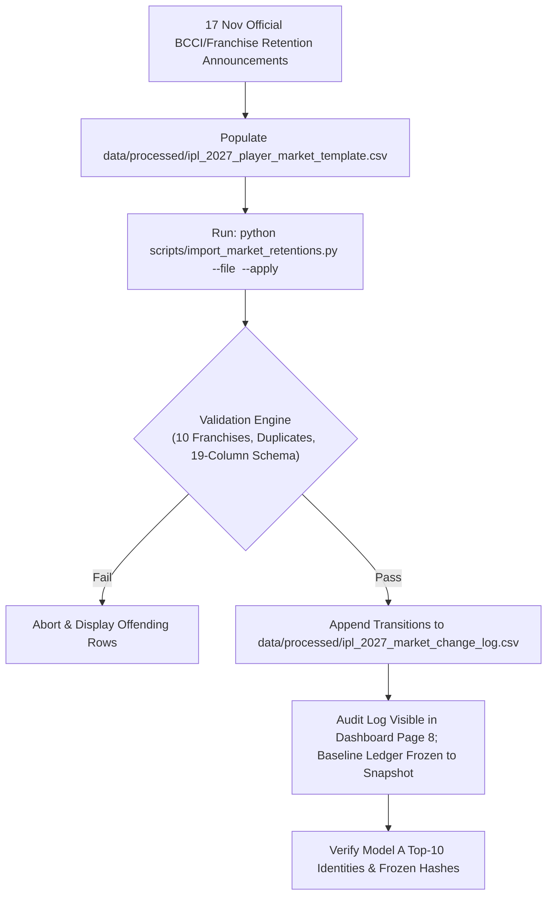

# PRESSUREIQ — November 17 Retention Update Runbook & Operational Protocol

**Document:** `docs/NOV17_RETENTION_UPDATE_RUNBOOK.md`  
**Date:** 15 November 2026  
**Status:** Certified Operational Runbook  
**Execution Window:** 17 November 2026 (Official IPL Retention Deadline)  
**Target Deadline:** 18 November 2026 (Round 1 Submission)  

---

## 1. Operational Objective & Scope

On **17 November 2026**, the Board of Control for Cricket in India (BCCI) and the ten Indian Premier League franchises will officially publish the final retention and release lists ahead of the IPL 2027 player auction.

The purpose of this runbook is to provide Rajasthan Royals analysts with a **failsafe, automated, and mathematically isolated protocol** to ingest these verified announcements into the PRESSUREIQ dashboard and market ledger without altering the frozen statistical baseline (Model A).



---

## 2. Strict Rules of Engagement

1. **Zero Impact on Statistical Scores:** Under no circumstances should an official retention, release, trade, or rumour alter a player's statistical reliability score, PAVA value, or Model A ranking. Statistical excellence is an empirical truth; market status is strategic context.
2. **Source Citation Required:** No player status transition can be recorded without an accredited, public source URL (official BCCI press release or franchise announcement).
3. **Audit Trail Preservation:** Status transitions must be appended to `data/processed/ipl_2027_market_change_log.csv` rather than overwriting historical events.

---

## 3. Step-by-Step Execution Protocol (17 November 2026)

### Step 1: Ingesting the Official Retention Lists
1. Collect the official releases from all 10 franchises:
   - Chennai Super Kings (CSK)
   - Mumbai Indians (MI)
   - Kolkata Knight Riders (KKR)
   - Sunrisers Hyderabad (SRH)
   - Rajasthan Royals (RR)
   - Royal Challengers Bengaluru (RCB)
   - Delhi Capitals (DC)
   - Lucknow Super Giants (LSG)
   - Gujarat Titans (GT)
   - Punjab Kings (PBKS)
2. Open the verified template: `data/processed/ipl_2027_player_market_template.csv`.
3. Update the fields for shortlisted candidates using only the **6 strict statuses** (`Confirmed Retained`, `Confirmed Released`, `Confirmed Trade`, `Pending Verification`, `Rumour`, `Policy/Eligibility Review`):
   - `official_retention_status`: Set to `Confirmed Retained`, `Confirmed Released`, `Confirmed Trade`, `Pending Verification`, `Rumour`, or `Policy/Eligibility Review`.
   - `official_release_status`: Set using the same strict 6-status taxonomy (or `Not Applicable (Trade)` on confirmed swaps; never mark unconfirmed players `Confirmed Available`).
   - `confirmed_trade_status`: Set to `Confirmed Trade` for verified player trades, or `None`.
   - `current_verified_franchise`: Update to the verified IPL franchise (e.g. `Chennai Super Kings`) or `None` if released/uncontracted.
   - `source_url`, `source_title`, `publisher`, `source_publication_date`: Enter the live verified official press release metadata.
   - `verification_timestamp`: Record current timestamp (`YYYY-MM-DD HH:MM:SS`).

### Step 2: Running Dry-Run Validation
Execute the ingestion script in dry-run mode (without `--apply`):
```bash
python scripts/import_market_retentions.py --file data/processed/ipl_2027_player_market_template.csv
```
The script will verify:
- Presence of all **19** required columns (`REQUIRED_COLUMNS`).
- Franchise naming consistency against `VALID_FRANCHISES`.
- Zero duplicate player IDs.
- Strict 6-status validation against `VALID_STATUSES` (plus live HTTPS URL & rejection of placeholder URLs).
- It will preview all detected movements in the terminal without mutating files.

### Step 3: Applying Updates to the Live Intelligence Ledger
Once dry-run validation outputs `PASS` for all checks, apply the updates:
```bash
python scripts/import_market_retentions.py --file data/processed/ipl_2027_player_market_template.csv --apply
```
This command automatically:
1. Reconciles player identities and writes the updated `data/processed/ipl_2027_player_market_template.csv`.
2. Logs each movement into `data/processed/ipl_2027_market_change_log.csv` (rendered in the Audit Log table on Dashboard Page 8 `Auction & Market Intelligence`; note that the baseline 11 Nov panel remains pinned to the immutable snapshot unless `build_market_snapshot` is intentionally refreshed after audit verification).
3. Verifies top-10 Model A player name order remains intact against `final_batter_rankings.csv` and `final_bowler_rankings.csv` (pair with `pytest tests/test_player_market_intelligence.py` to assert full SHA-256 checksums).

---

## 4. Handling Unexpected Market Scenarios

| Market Scenario | Example | Required Operational Handling |
|:---|:---|:---|
| **High-Priority Watchlist Player is Retained** | Romario Shepherd (RCB 2026 squad) retained ahead of 2027. | Update `official_retention_status` to `Confirmed Retained`. Reclassify strategy from watchlist candidate to *Opposition Benchmark*. Retain Model A score unchanged. |
| **Star Player is Released** | Unforeseen Nov 17 release of a contracted player (e.g., Naman Dhir / Jitesh Sharma). | Update `official_retention_status` & `official_release_status` to `Confirmed Released` with official BCCI press-release URL. Unlocks auction bidding analysis in Page 8/9. |
| **Player Traded During Window** | Nathan Ellis traded CSK -> SRH (5 Nov 2026). | Record `Confirmed Trade` in `official_retention_status` and `confirmed_trade_status`, set `official_release_status` to `Not Applicable (Trade)`, and cite official IPL announcement. |
| **Uncapped Domestic Pacer Retained** | Prince Yadav (LSG 2026 squad) retained on Nov 17. | Record `Confirmed Retained` with official source URL; maintain Model A #11 rank unchanged. |

---

## 5. Pre-Submission Re-Verification Checklist (18 November 2026)

Before final portal entry on 18 November:
- [ ] Run `python -m pytest tests/ -v` and verify **all unit tests pass**.
- [ ] Run `python scripts/test_streamlit_headless.py` and verify **clean dashboard execution**.
- [ ] Verify `PRESSUREIQ_Final_Submission.zip` checksum matches `76059a8f5f8b8de5126a5ed8b2a9378fb6664016989f3125df7ca4bbbe9696db`.
- [ ] Verify `docs/PRESSUREIQ_FINAL_METHODOLOGY_REPORT.pdf` (14 pages) and `final_*_rankings.csv` hashes remain intact.
- [ ] Review Page 8 (`Auction & Market Intelligence`) and `ipl_2027_market_change_log.csv` to confirm logged Nov 17 announcements.

**Verdict:** The November 17 ingestion pipeline is fully operational, hardened, and ready for execution upon official announcements.

