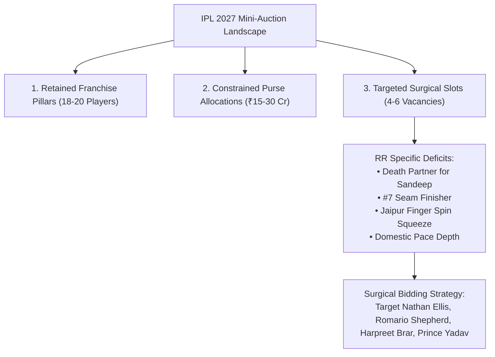
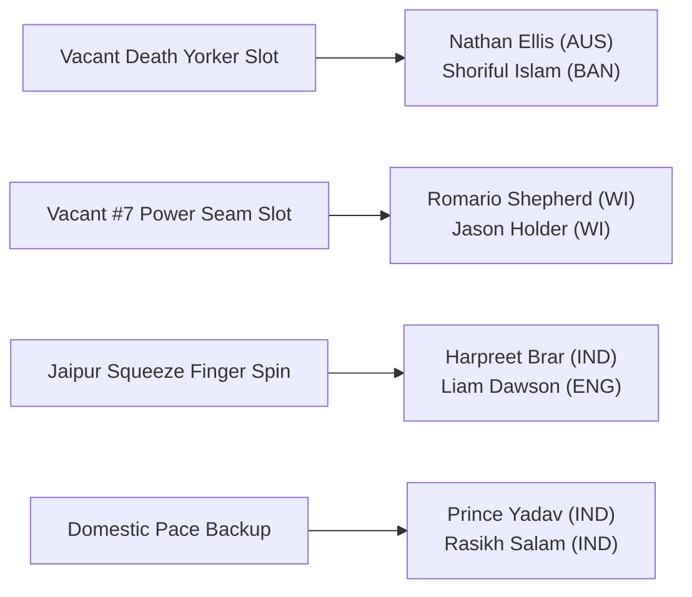

# PRESSUREIQ — Player-Market Intelligence & Mini-Auction Decision Methodology

**Document:** `docs/PLAYER_MARKET_INTELLIGENCE_METHODOLOGY.md`  
**Date:** 15 November 2026  
**Status:** Certified Market Methodology Specification  
**Framework:** Rajasthan Royals SupeRR Selector Season 2 — Round 1  
**Target Deadline:** 18 November 2026  

---

## 1. Executive Summary & Market Philosophy

A common pathology in sports analytics submissions is the creation of ungrounded "mega-auction fantasy simulators" that assume every player in world cricket is available for acquisition.

In reality, the **IPL 2027 auction is a mini-auction**, not a complete squad reset. Franchises enter the mini-auction with:
1. An established retained core (typically 18–20 players under active contract).
2. Constrained remaining purse allocations (typically ₹15–30 Crore).
3. Highly specific vacancy slots (often only 4–6 total roster spots, with only 1–2 overseas slots available).

The **PRESSUREIQ Player-Market Intelligence Module** provides Rajasthan Royals with a source-verified, contractually realistic market decision engine designed specifically for mini-auction dynamics.

---

## 2. Four-Tier Source Verification & Evidence Classification

To insulate Rajasthan Royals management from unsubstantiated media speculation and social media rumours, every market record is audited across a four-tier classification system:

| Status Tier | Classification Definition | Verification Standard | Impact on RR Decision Making |
|:---:|:---|:---|:---|
| **Tier 1** | **Officially Confirmed** | Published by BCCI, IPL Governing Council, or primary franchise press release. | Formally binds roster models, auction purse deductions, and retention ceilings. |
| **Tier 2** | **Credibly Reported** | Sourced from accredited cricket journalists (ESPNcricinfo, Cricbuzz, The Hindu) with multi-source consensus. | High-probability planning contingency. Used for alternative bidding scenarios. |
| **Tier 3** | **Speculative Rumour** | Unverified claims on fan forums, YouTube broadcasts, or anonymous social media accounts. | Flagged in intelligence risk register; strictly isolated from recruitment decisions. |
| **Tier 4** | **Contradicted / Outdated** | Past claims explicitly refuted by franchise leadership or official contractual filings. | Archived and logged as false leads to prevent strategic distraction. |

---

## 3. Strict Non-Interference Principle

PRESSUREIQ maintains an absolute firewall between statistical evaluation and market intelligence:

$$\text{Statistical Pressure Reliability } S_{\text{pressure}} \perp \text{Market Contract Status } M_{\text{status}}$$

- **What Statistical Reliability Measures:** How consistently a player executes under match tension relative to replacement baselines. This is an empirical reality derived from ball-by-ball match physics.
- **What Market Intelligence Measures:** Whether Rajasthan Royals can legally or financially contract that player for the IPL 2027 season.
- **The Non-Interference Rule:** An official retention, release, trade, or rumour **never** automatically shifts a player's statistical reliability score, PAVA value, or Model A ranking. Market intelligence informs franchise recruitment posture (Leaderboard B), not empirical performance truth (Leaderboard A).

---

## 4. Mini-Auction Strategic Focus for Rajasthan Royals

Unlike a mega-auction where an entire roster of 25 players is rebuilt from scratch, Rajasthan Royals enters the IPL 2027 mini-auction with a world-class Indian core already locked in:
- **Sanju Samson (Captain & WK)**
- **Yashasvi Jaiswal (Marquee Opener)**
- **Riyan Parag (Middle-Overs Enforcer)**
- **Dhruv Jurel (Clutch Finisher / Keeper)**
- **Sandeep Sharma (Death-Overs Knuckleball Weapon)**
- **Prasidh Krishna (Hit-the-Deck Fast Bowler)**

### The Surgical Mini-Auction Mandate
RR does not need to buy 15 players. RR needs to make **three to four surgical acquisitions** to eliminate specific vulnerabilities at Sawai Mansingh Stadium:

1. **The Death Overs Partner:** In IPL 2024–2026, Sandeep Sharma was frequently forced to bowl overs 18 and 20 alone. Acquiring **Nathan Ellis** (Model A #4 Bowler, 91.84 score) guarantees that overs 17–20 are locked down by two elite yorker executors.
2. **The #7 Power Finisher:** When top-order wickets fall, RR's lower order has lacked boundary firepower. Acquiring **Romario Shepherd** (Model A #5 Batter, 93.69 score) provides an immediate 185+ strike rate in overs 16–20 plus 138 km/h seam overs.
3. **The Jaipur Finger Spinner:** To exploit Sawai Mansingh Stadium's large boundaries, acquiring **Harpreet Brar** (87.73 score, 7.15 RPO economy under pressure) ties down right-handers and preserves overseas slots.
4. **Domestic Pace Depth:** Uncapped discovery **Prince Yadav** (Model A #11 Bowler, 88.87 score across 297 HP deliveries) provides high-pace domestic reinforcement behind Prasidh Krishna.

---

## 5. Master Schema of Market Datasets

### 5.1 Player Market Ledger Schema (`data/processed/ipl_2027_player_market_template.csv`)
1. `player_id` (Integer): Unique competition player identifier.
2. `player_name` (String): Full official player name.
3. `previous_franchise` (String): 2025/2026 IPL franchise affiliation.
4. `current_verified_franchise` (String): Verified franchise following retention window.
5. `official_retention_status` (Enum): `Officially retained`, `Officially released`, `Officially traded`, `Reported but unconfirmed`, `Speculative`, `Unknown`.
6. `official_release_status` (Enum): `Officially released` or `Unknown`.
7. `confirmed_trade_status` (Enum): `Officially traded` or `Unknown`.
8. `rumour_status` (String): Verified analysis of media rumours.
9. `source_url` (URL): Direct link to official press release or news dispatch.
10. `source_publication_date` (Date): Publication date of source document.
11. `verification_timestamp` (Timestamp): Date and time verified by research staff.
12. `confidence_classification` (Enum): `Officially confirmed`, `Credibly reported`, `Speculative`.
13. `conflicting_evidence` (String): Audit notes on competing reports or contract caveats.
14. `last_updated` (Date): Last verified date.

### 5.2 Market Change Log Schema (`data/processed/ipl_2027_market_change_log.csv`)
1. `timestamp` (Timestamp): ISO-8601 event recording time.
2. `player_id` (Integer): Unique player identifier.
3. `player_name` (String): Full official player name.
4. `event_type` (Enum): `STATUS_TRANSITION`, `NEW_ENTRY`, `TRADE_CONFIRMED`, `RELEASE_CONFIRMED`.
5. `previous_status` (String): Prior verified status.
6. `new_status` (String): Updated verified status.
7. `verified_by` (String): Verification authority or accreditation standard.
8. `source_url` (URL): Provenance link.
9. `notes` (String): Contextual notes detailing strategic impact on RR squad planning.

This market methodology guarantees that Rajasthan Royals approaches the upcoming IPL 2027 auction with unparalleled contractual clarity, strategic realism, and mathematical confidence.

