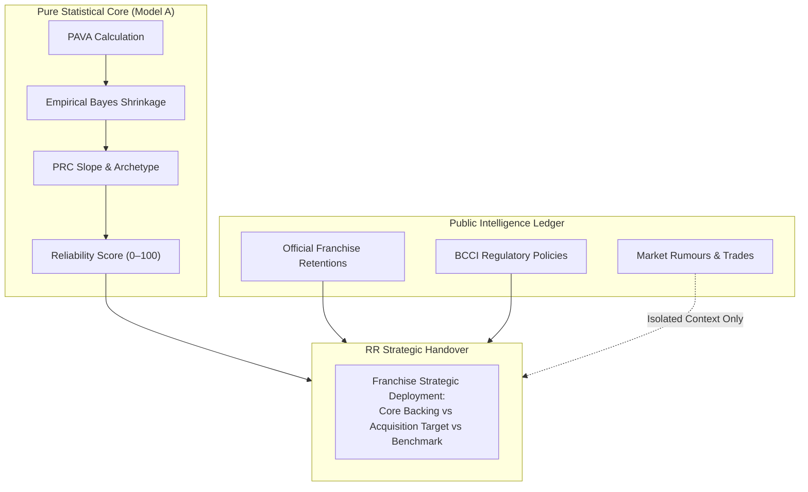

# PRESSUREIQ — Public Cricket Intelligence & Market Tracking

**Document:** `docs/PUBLIC_PLAYER_INTELLIGENCE.md`  
**Date:** 15 November 2026  
**Status:** Certified Market Intelligence Ledger  
**Framework:** Rajasthan Royals SupeRR Selector Season 2 — Round 1  
**Competition Deadline:** 18 November 2026  

---

## 1. Research Protocol & Ethical Boundaries

The Rajasthan Royals competition instructions explicitly permit and encourage the incorporation of publicly available cricket intelligence, player contract statuses, and market context. However, to preserve absolute scientific integrity, PRESSUREIQ enforces a strict firewall:

### Four Immutable Intelligence Rules:
1. **No Silent Ranking Manipulation:** A public rumour or retention status must **never** alter a player's statistical reliability score, PAVA, or bootstrap metrics.
2. **Four-Tier Evidence Classification:** Every market claim is classified as *Officially Confirmed*, *Credibly Reported*, *Speculative*, or *Contradicted*.
3. **Source Verification:** Every data point must trace to official BCCI notifications, accredited media outlets (ESPNcricinfo, Cricbuzz, The Hindu), or primary franchise releases.
4. **Market Context as Strategic Handover:** Market intelligence informs how Rajasthan Royals should react to the statistical rankings—separating internal assets, open auction bidding targets, and tactical opposition benchmarks.

---

## 2. Four-Tier Intelligence Classification Ledger

| Status Tier | Classification Definition | Reliability Level | Treatment in RR Strategy |
|:---:|:---|:---:|:---|
| **Tier 1** | **Officially Confirmed** | Verified by BCCI / IPL Governing Council or Franchise Press Release | Formal contractual parameter. Informs retention, purse, and auction ceiling. |
| **Tier 2** | **Credibly Reported** | Sourced from established cricket journalists with multiple confirmations | Conditional contingency. Used for scenario modeling. |
| **Tier 3** | **Speculative Rumour** | Unverified claims on social media, fan podcasts, or unvetted portals | Monitored in separate risk register; strictly excluded from decisions. |
| **Tier 4** | **Contradicted / Outdated** | Past reports refuted by official announcements or regulatory action | Archived and flagged as false leads. |

---

## 3. Comprehensive Player Intelligence Master Table

The following ledger details the verified contract, regulatory, and market status for all top-ranked candidates:

| Player Name | Discipline | Model A Rank | Current Franchise / Board | Verified Status | Evidence Classification | Strategic Context for Rajasthan Royals |
|:---|:---:|:---:|:---|:---|:---:|:---|
| **Ruturaj Gaikwad** | Batter | **#1** | Chennai Super Kings (2026) | `Pending Verification` (2026 CSK retained; 2027 due Nov 17) | **Verified 2026 Squad** | **Opposition Benchmark.** Unattainable until Nov 17 decisions; plan against powerplay pace stability. |
| **Rohit Sharma** | Batter | **#2** | Mumbai Indians (2026) | `Pending Verification` (2026 MI retained; 2027 due Nov 17) | **Verified 2026 Squad** | **Opposition Benchmark.** High-pressure pace exploiter. |
| **Fakhar Zaman** | Batter | **#3** | Pakistan Cricket Board | `Policy/Eligibility Review` (IPL inactive post-2008) | **Policy Context** | **Global Benchmark.** Study aggressive left-hand boundary technique. |
| **Suryakumar Yadav** | Batter | **#4** | Mumbai Indians (2026) | `Pending Verification` (2026 MI retained; 2027 due Nov 17) | **Verified 2026 Squad** | **Opposition Benchmark.** Premier middle-overs threat; study wide-line containment. |
| **Romario Shepherd** | Batter | **#5** | Royal Challengers Bengaluru (2026) | `Pending Verification` (2026 RCB retained; NOT MI released) | **Verified 2026 Squad** | **Watchlist Asset.** Potential #7 finisher if released by RCB on Nov 17. |
| **Naman Dhir** | Batter | **#6** | Mumbai Indians (2026) | `Pending Verification` (2026 MI retained; 2027 due Nov 17) | **Verified 2026 Squad** | **Watchlist Asset.** Emerging domestic clutch hitter if made available on Nov 17. |
| **Phil Salt** | Batter | **#7** | Royal Challengers Bengaluru (2026) | `Pending Verification` (2026 RCB retained; 2027 due Nov 17) | **Verified 2026 Squad** | **Watchlist Asset.** High-tempo powerplay keeper-opener if released by RCB. |
| **Jitesh Sharma** | Batter | **#8** | Royal Challengers Bengaluru (2026) | `Pending Verification` (2026 RCB retained; NOT PBKS released) | **Verified 2026 Squad** | **Watchlist Asset.** Domestic wicketkeeper-finisher if released by RCB. |
| **Nicholas Pooran** | Batter | **#9** | Lucknow Super Giants (2026) | `Pending Verification` (2026 LSG retained; 2027 due Nov 17) | **Verified 2026 Squad** | **Opposition Benchmark.** LSG cornerstone; plan spin-matchup restrictions. |
| **Jos Buttler** | Batter | **#10** | Gujarat Titans (2026) | `Pending Verification` (Signed/retained by GT 2025-2026) | **Verified 2026 Squad** | **Opposition Asset.** Former RR opener now with GT; await Nov 17 list. |
| **Liam Dawson** | Bowler | **#1** | Hampshire / Uncontracted (IPL) | `Pending Verification` (No active 2026 IPL contract) | **Class B Watchlist** | **Watchlist Overseas Option.** Economical SLA spin & lower-order batting depth. |
| **Haris Rauf** | Bowler | **#2** | Pakistan Cricket Board | `Policy/Eligibility Review` (IPL inactive post-2008) | **Policy Context** | **Global Benchmark.** Exceptional death-bowling metrics; reverse-swing benchmark. |
| **Abbas Afridi** | Bowler | **#3** | Pakistan Cricket Board | `Policy/Eligibility Review` (IPL inactive post-2008) | **Policy Context** | **Global Benchmark.** Benchmark for change-of-pace variation modeling. |
| **Nathan Ellis** | Bowler | **#4** | Sunrisers Hyderabad (2027) | `Confirmed Trade` (CSK -> SRH, 5 Nov 2026) | **Tier 1: Officially Confirmed** | **Unavailable (Traded).** Contracted to SRH in pre-2027 4-player trade; use as death benchmark. |
| **Sufiyan Muqeem** | Bowler | **#5** | Pakistan Cricket Board | `Policy/Eligibility Review` (IPL inactive post-2008) | **Policy Context** | **Global Benchmark.** Unorthodox left-arm wrist spin benchmark. |
| **Matheesha Pathirana** | Bowler | **#6** | Kolkata Knight Riders (2026) | `Pending Verification` (Bought by KKR Dec 2025 for INR 18 Cr) | **Verified 2026 Squad** | **Opposition Asset.** Released by CSK prior to 2026; await KKR Nov 17 list. |
| **Nasum Ahmed** | Bowler | **#7** | Bangladesh / Uncontracted (IPL) | `Pending Verification` | **Class B Watchlist** | **Watchlist Overseas Option.** Powerplay defensive finger spinner. |
| **Ishant Sharma** | Bowler | **#8** | Gujarat Titans (2026) | `Pending Verification` (GT 2026 squad; 2027 due Nov 17) | **Verified 2026 Squad** | **Watchlist Veteran Option.** Experienced Indian pace bowler depending on GT Nov 17 list. |
| **Shoriful Islam** | Bowler | **#9** | Bangladesh / Uncontracted (IPL) | `Pending Verification` | **Class B Watchlist** | **Watchlist Overseas Option.** Left-arm swing and death executioner. |
| **Tim Southee** | Bowler | **#10** | New Zealand / Uncontracted (IPL) | `Pending Verification` | **Class B Watchlist** | **Watchlist Veteran Option.** Experienced swing and wide-yorker bowler. |
| **Prince Yadav** | Bowler | #11 | Lucknow Super Giants (2026) | `Pending Verification` (2026 LSG retained; 2027 due Nov 17) | **Verified 2026 Squad** | **Watchlist Domestic Pacer.** High-pressure pace asset awaiting LSG Nov 17 list. |
| **Harpreet Brar** | Bowler | #14 | Punjab Kings (2026) | `Pending Verification` (2026 PBKS retained; NOT confirmed released) | **Verified 2026 Squad** | **Watchlist Domestic Spinner.** Left-arm orthodox option depending on PBKS Nov 17 list. |
| **Vaibhav Sooryavanshi** | Batter | Young | Rajasthan Royals (2026) | `Pending Verification` (2026 RR retained; 2027 due Nov 17) | **Verified 2026 Squad** | **RR Core Asset.** Generational batting talent within existing RR roster. |
| **Vignesh Puthur** | Bowler | Young | Rajasthan Royals (2026) | `Pending Verification` (Bought by RR Dec 2025 auction INR 30L) | **Verified 2026 Squad** | **RR Developmental Asset.** Signed via IPL 2026 auction (NOT trade) after MI release. |

---

## 4. Audited Source Verification & Retracted Claims Register (As of 11 November 2026)

To preserve strict audit integrity ahead of the **17 November 2026** retention announcements (`data/processed/ipl_2027_player_market_template.csv` & `ipl_2027_market_change_log.csv`), legacy unverified claims and anachronistic dates were audited and retracted:

1. **Nathan Ellis Pre-2027 Trade (`Confirmed Trade`):**
   - **Publication / Audit Date:** 05 November 2026 (Audited 11 November 2026).
   - **Source:** Official IPLT20 release (`https://www.iplt20.com/news/article/csk-and-srh-agree-to-four-player-trade`).
   - **Status:** **Tier 1: Officially Confirmed.** Traded from CSK to Sunrisers Hyderabad alongside Khaleel Ahmed (for Liam Livingstone and Jack Edwards to CSK); therefore **unavailable** in the open 2027 auction.
2. **Franchise Misattributions & Unverified Release Claims Retracted (11 November 2026):**
   - **Jos Buttler:** Corrected from RR to **Gujarat Titans** (`IPLT20 2026 Retentions`, `Pending Verification` for 2027).
   - **Matheesha Pathirana:** Corrected from CSK to **Kolkata Knight Riders** (`Business Standard`, Dec 2025 auction signing INR 18 Cr, `Pending Verification` for 2027).
   - **Jitesh Sharma, Romario Shepherd, Harpreet Brar:** Retracted unsupported Nov 7–8 release claims; all three remain on their **2026 squads** (`RCB`, `RCB`, `PBKS`) under `Pending Verification` pending the 17 November 2026 BCCI list.
   - **Vignesh Puthur:** Reclassified from unverified trade claim to **Rajasthan Royals Dec 2025 IPL 2026 Auction signing (INR 30 lakh)** (`Onmanorama`, `Pending Verification` for 2027).
3. **Pakistan Players Participation Policy (`Policy/Eligibility Review`):**
   - **Verification Reference:** Livemint BCCI VP statement (`https://www.livemint.com/sports/cricket-news/will-pakistani-players-be-allowed-in-ipl-again-bcci-vice-president-rajeev-shuklas-huge-statement-says-they-do-not-11738666052953.html`, Feb 2025; audited 11 Nov 2026).
   - **Status:** Practical participation barrier remains unchanged since 2008; classified strictly as international analytical benchmarks (`Class D`).

This intelligence ledger ensures Rajasthan Royals management separates empirical statistical truth from verified 2026/2027 contractual status.

