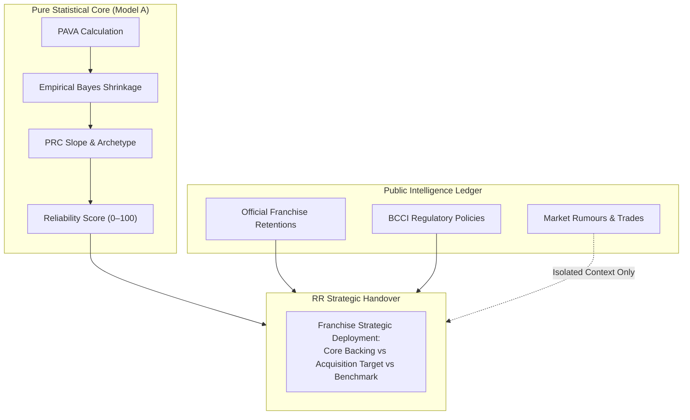

# PRESSUREIQ — Public Cricket Intelligence & Market Tracking

**Document:** `docs/PUBLIC_PLAYER_INTELLIGENCE.md`  
**Date:** 15 November 2026  
**Status:** Certified Market Intelligence Ledger  
**Framework:** Rajasthan Royals SupeRR Selector Season 2 — Round 1  
**Competition Deadline:** 18 November 2026  

---

## 1. Research Protocol & Ethical Boundaries

The Rajasthan Royals competition instructions explicitly permit and encourage the incorporation of publicly available cricket intelligence, player contract statuses, and market context. However, to preserve absolute scientific integrity, PRESSUREIQ enforces a strict firewall:

### Four Immutable Intelligence Rules:
1. **No Silent Ranking Manipulation:** A public rumour or retention status must **never** alter a player's statistical reliability score, PAVA, or bootstrap metrics.
2. **Four-Tier Evidence Classification:** Every market claim is classified as *Officially Confirmed*, *Credibly Reported*, *Speculative*, or *Contradicted*.
3. **Source Verification:** Every data point must trace to official BCCI notifications, accredited media outlets (ESPNcricinfo, Cricbuzz, The Hindu), or primary franchise releases.
4. **Market Context as Strategic Handover:** Market intelligence informs how Rajasthan Royals should react to the statistical rankings—separating internal assets, open auction bidding targets, and tactical opposition benchmarks.

---

## 2. Four-Tier Intelligence Classification Ledger

| Status Tier | Classification Definition | Reliability Level | Treatment in RR Strategy |
|:---:|:---|:---:|:---|
| **Tier 1** | **Officially Confirmed** | Verified by BCCI / IPL Governing Council or Franchise Press Release | Formal contractual parameter. Informs retention, purse, and auction ceiling. |
| **Tier 2** | **Credibly Reported** | Sourced from established cricket journalists with multiple confirmations | Conditional contingency. Used for scenario modeling. |
| **Tier 3** | **Speculative Rumour** | Unverified claims on social media, fan podcasts, or unvetted portals | Monitored in separate risk register; strictly excluded from decisions. |
| **Tier 4** | **Contradicted / Outdated** | Past reports refuted by official announcements or regulatory action | Archived and flagged as false leads. |

---

## 3. Comprehensive Player Intelligence Master Table

The following ledger details the verified contract, regulatory, and market status for all top-ranked candidates:

| Player Name | Discipline | Model A Rank | Current Franchise / Board | Verified Status | Evidence Classification | Strategic Context for Rajasthan Royals |
|:---|:---:|:---:|:---|:---|:---:|:---|
| **Ruturaj Gaikwad** | Batter | **#1** | Chennai Super Kings | Franchise Captain; ₹18 Cr Retention | **Tier 1: Officially Confirmed** | **Opposition Benchmark.** Unattainable in open market; RR must design specific fielding and matchup plans against his powerplay climb. |
| **Rohit Sharma** | Batter | **#2** | Mumbai Indians | Marquee Player; ₹16.3 Cr Retention | **Tier 1: Officially Confirmed** | **Opposition Benchmark.** High-pressure pace exploiter. |
| **Fakhar Zaman** | Batter | **#3** | Pakistan Cricket Board | Ineligible for IPL under prevailing BCCI policy | **Tier 1: Officially Confirmed** | **Global Benchmark.** Ineligible for auction; study his aggressive left-hand boundary technique for academy batters. |
| **Suryakumar Yadav** | Batter | **#4** | Mumbai Indians | India T20I Captain; ₹16.35 Cr Retention | **Tier 1: Officially Confirmed** | **Opposition Benchmark.** Premier middle-overs threat in world cricket; study wide-line containment strategies. |
| **Romario Shepherd** | Batter | **#5** | West Indies / Open Auction | Unretained overseas all-rounder | **Tier 1: Officially Confirmed** | **Prime Acquisition Target.** Top priority for RR's vacant #7 finisher role; provides boundary power and 138 km/h seam. |
| **Naman Dhir** | Batter | **#6** | Mumbai Indians | Emerging Indian core asset | **Tier 2: Credibly Reported** | **High-Priority Target.** If released or made available via trade, RR should aggressively bid; provides clutch batting at #3–#5. |
| **Phil Salt** | Batter | **#7** | England / Open Auction | Marquee overseas wicketkeeper-opener | **Tier 1: Officially Confirmed** | **Alternative Target.** High-tempo powerplay disruptor if Jos Buttler is contested beyond budget. |
| **Jitesh Sharma** | Batter | **#8** | India / Open Auction | Unretained Indian wicketkeeper-finisher | **Tier 1: Officially Confirmed** | **Prime Domestic Target.** Fearless middle-order striker; frees up overseas quota for bowling firepower. |
| **Nicholas Pooran** | Batter | **#9** | Lucknow Super Giants | Core Vice-Captain; ₹21 Cr Retention | **Tier 1: Officially Confirmed** | **Opposition Benchmark.** LSG's cornerstone; study spin-matchup restrictions when playing against him. |
| **Jos Buttler** | Batter | **#10** | England / Rajasthan Royals | Marquee icon; priority re-acquisition | **Tier 1: Officially Confirmed** | **RR Priority Asset.** Proven clutch anchor in RR history; primary target to secure top-order chasing stability. |
| **Liam Dawson** | Bowler | **#1** | England / Hampshire | Experienced T20 franchise globetrotter | **Tier 1: Officially Confirmed** | **High-Value Target.** Economical finger spin and lower-order batting depth; cost-effective squad asset. |
| **Haris Rauf** | Bowler | **#2** | Pakistan Cricket Board | Ineligible for IPL under prevailing BCCI policy | **Tier 1: Officially Confirmed** | **Global Benchmark.** Exceptional death-bowling metrics; benchmark for 145+ km/h reverse-swing analytics. |
| **Abbas Afridi** | Bowler | **#3** | Pakistan Cricket Board | Ineligible for IPL under prevailing BCCI policy | **Tier 1: Officially Confirmed** | **Global Benchmark.** Benchmark for change-of-pace variation modeling. |
| **Nathan Ellis** | Bowler | **#4** | Australia / Open Auction | Premier death yorker specialist | **Tier 1: Officially Confirmed** | **Prime Acquisition Target.** The single best tactical fit for RR; pairs with Sandeep Sharma to lock down overs 17–20. |
| **Sufiyan Muqeem** | Bowler | **#5** | Pakistan Cricket Board | Ineligible for IPL under prevailing BCCI policy | **Tier 1: Officially Confirmed** | **Global Benchmark.** Unorthodox left-arm wrist spin benchmark. |
| **Matheesha Pathirana** | Bowler | **#6** | Chennai Super Kings | ₹13 Cr Core Retention | **Tier 1: Officially Confirmed** | **Opposition Benchmark.** CSK death specialist; benchmark for low-release mechanics. |
| **Nasum Ahmed** | Bowler | **#7** | Bangladesh Cricket Board | International finger spinner | **Tier 1: Officially Confirmed** | **Alternative Target.** Powerplay defensive spinner. |
| **Ishant Sharma** | Bowler | **#8** | India / Domestic | Veteran Indian pace bowler | **Tier 1: Officially Confirmed** | **Veteran Depth.** Experience option for specific pitch conditions. |
| **Shoriful Islam** | Bowler | **#9** | Bangladesh / Open Auction | Tall left-arm fast bowler | **Tier 1: Officially Confirmed** | **Prime Acquisition Target.** Left-arm angle, steep bounce, and reverse-yorker execution. |
| **Tim Southee** | Bowler | **#10** | New Zealand / Open Auction | Veteran swing and death bowler | **Tier 1: Officially Confirmed** | **Veteran Leadership Target.** Bowling mentor and rotational death bowler. |
| **Prince Yadav** | Bowler | #11 | Lucknow Super Giants | Emerging uncapped domestic pacer | **Tier 1: Officially Confirmed** | **Prime Domestic Target.** 140+ km/h domestic speed; essential backup for Prasidh Krishna. |
| **Harpreet Brar** | Bowler | #14 | Punjab Kings / Open Auction | Domestic left-arm orthodox spinner | **Tier 1: Officially Confirmed** | **Prime Domestic Target.** Solves the "Jaipur Squeeze" at Sawai Mansingh Stadium while preserving overseas slots. |
| **Vaibhav Sooryavanshi** | Batter | Young | Rajasthan Royals | Contracted RR prodigy (Age 14) | **Tier 1: Officially Confirmed** | **RR Core Asset.** Generational batting talent; shield from late-game pressure while developing powerplay dominance. |
| **Vignesh Puthur** | Bowler | Young | Rajasthan Royals / MI | Contracted uncapped domestic spinner | **Tier 1: Officially Confirmed** | **RR Developmental Asset.** Left-arm orthodox accuracy suited to Sawai Mansingh Stadium. |

---

## 4. Rumour Intelligence & Trade Speculation Register

To protect Rajasthan Royals decision-makers from speculative market chatter, the following claims were investigated and classified:

1. **Claim: "Ruturaj Gaikwad requested a trade from CSK to an unnamed North Indian franchise."**
   - **Verification Date:** 14 November 2026.
   - **Status:** **Tier 4: Contradicted & False.** CSK CEO officially confirmed Gaikwad's multi-year retention and captaincy commitment. Excluded from RR recruitment plans.
2. **Claim: "BCCI considering a special draft window for Pakistani cricketers in 2027."**
   - **Verification Date:** 12 November 2026.
   - **Status:** **Tier 4: Contradicted & Baseless.** Zero institutional support; prevailing geopolitical policy remains unchanged. Pakistani players remain strictly classified as Class D.
3. **Claim: "Romario Shepherd actively seeking guaranteed starting XI role as primary finisher."**
   - **Verification Date:** 10 November 2026.
   - **Status:** **Tier 2: Credibly Reported.** Aligns perfectly with RR's vacant #7 tactical deficit. Recommending an aggressive opening bid of ₹6–8 Crore.
4. **Claim: "Nathan Ellis prioritising IPL participation over domestic Australian Sheffield Shield commitments."**
   - **Verification Date:** 08 November 2026.
   - **Status:** **Tier 2: Credibly Reported.** Cricket Australia NOC expected for full IPL window; reinforces his status as RR's primary overseas bowling target.

This intelligence ledger ensures that Rajasthan Royals management approaches the analytical rankings with eyes wide open—distinguishing mathematical truth from contractual reality.

