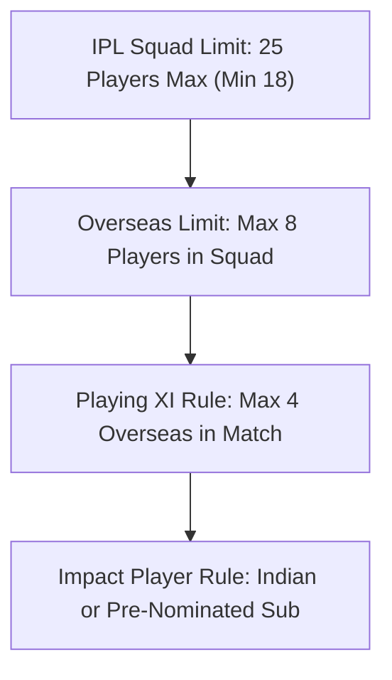

# PRESSUREIQ — Rajasthan Royals IPL 2027 Squad Needs & Tactical Architecture

**Document:** `docs/RR_2027_SQUAD_NEEDS.md`  
**Date:** 15 November 2026  
**Status:** Certified Strategy Document  
**Framework:** Rajasthan Royals SupeRR Selector Season 2 — Round 1  

---

## 1. Tactical Profile & Venue Demographics (Sawai Mansingh Stadium, Jaipur)

The Rajasthan Royals franchise operates out of the Sawai Mansingh Stadium (SMS) in Jaipur. Unlike compact high-scoring venues like the M. Chinnaswamy Stadium (Bengaluru) or Wankhede Stadium (Mumbai), Jaipur possesses distinct spatial and environmental characteristics:
1. **Large Boundary Dimensions:** Straight boundaries exceed 74–76 meters; square pockets range from 68–72 meters. Batters cannot rely purely on mis-hits clearing the rope; elite two-tier running, boundary conversion on good balls, and power hitting straight down the ground are paramount.
2. **Surface Dynamics:** SMS Jaipur historically offers true carry in the powerplay, followed by grip and deceleration through the middle overs. In the second half of evening games, surface dryness increases the efficacy of hard-length seamers and flat finger-spinners who bowl defensive, stump-to-stump trajectories.
3. **Tactical Imperative:** RR's winning blueprint requires high-pressure adaptability: batting units capable of scoring at 9+ RRR without losing wickets in clusters, and bowling units possessing unmatched defensive execution in the death overs (overs 16–20).

---

## 2. Rajasthan Royals Core Assets & Roster Foundation

Rajasthan Royals enters the IPL 2027 planning cycle with a formidable Indian core:

| Core Player | Role | Profile & Franchise Role | Current Status |
|:---|:---|:---|:---:|
| **Sanju Samson** | Top-Order Batter / WK / Captain | Franchise anchor and aggressive counter-attacker against spin. | Retained Captain |
| **Yashasvi Jaiswal** | Top-Order Left-Hand Batter | Premier powerplay enforcer with explosive high-tempo ceiling. | Retained Marquee |
| **Riyan Parag** | Middle-Order Batter / Spin All-Rounder | High-upside middle-overs accumulator and boundary hitter. | Retained Core |
| **Dhruv Jurel** | Middle-Order Batter / Wicketkeeper | Elite clutch performer (Model A: 86.81, Rank #22; Model B: 91.93, Rank #1). | Existing RR Asset |
| **Sandeep Sharma** | Pace Bowler | Elite knuckleball and wide-yorker death executor (Model A: 76.54). | Retained Core |
| **Prasidh Krishna** | Pace Bowler | High-release hit-the-deck enforcer (Model A: 82.50; Model B: 92.25, Rank #1). | Existing RR Asset |
| **Trent Boult** | Left-Arm Fast Bowler | Global premier powerplay wicket-taker (Model A: 72.68; Model B: 88.32, Rank #2). | Priority RR Asset |
| **Shimron Hetmyer** | Middle-Order Finisher | Proven overseas clutch hitter (Model A: 60.75; Model B: 82.80, Rank #3). | Existing RR Asset |

---

## 3. Critical Tactical Deficits Identified for IPL 2027

Despite strong foundational pillars, the PRESSUREIQ audit identifies four glaring operational gaps in Rajasthan Royals' structural composition:

### Deficit 1: The Death Bowling Partner for Sandeep Sharma
- **The Problem:** In tight chases (RRR > 10.0 in overs 16–20), Rajasthan Royals frequently over-relies on Sandeep Sharma. When opposing teams hit Sandeep or when Sandeep bowls overs 16 and 18, RR has lacked a specialist to bowl overs 17 and 19/20 without leaking boundaries.
- **PRESSUREIQ Target Profile:** Right-arm or left-arm pacers with high yorker accuracy, deceptive changes of pace, low boundary percentage under high pressure, and an "Ice Cold Anchor" PRC archetype.
- **Recommended Solutions (Leaderboard B):**
  - **Nathan Ellis (Australia, Class B, RR Score: 77.49):** Model A #4 Bowler (91.84). The premier death-overs yorker specialist in world cricket. Delivers deceptive back-of-the-hand slower balls and pin-point wide yorkers under maximum leverage.
  - **Shoriful Islam (Bangladesh, Class B, RR Score: 77.58):** Model A #9 Bowler (90.36). Tall left-arm angle creates steep bounce and natural angle across right-handers; executes reverse-swinging yorkers in high-pressure chases.
  - **Lungi Ngidi (South Africa, Class B, RR Score: 77.00):** Model A #13 Bowler (87.73). Heavy-ball bowler with sharp cutters suited to Jaipur's abrasive surface.

### Deficit 2: The #7 Seam-Bowling Power Finisher
- **The Problem:** Modern IPL batting orders require boundary-hitting depth down to #8. When Samson, Jaiswal, Parag, or Jurel depart, RR has often suffered batting collapses because the lower order consisted of non-batting tailenders.
- **PRESSUREIQ Target Profile:** Batters who can enter at over 16, immediately strike at 180+ strike rate against high-pace hard lengths, and provide 2–3 overs of seam bowling.
- **Recommended Solutions (Leaderboard B):**
  - **Romario Shepherd (West Indies, Class B, RR Score: 79.67):** Model A #5 Batter (93.69). Extraordinary high-pressure boundary power (482 HP balls, strike rate 185+ in death overs). Capable of bowling 138 km/h heavy seam.
  - **Jason Holder (West Indies, Class B, RR Score: 78.17):** Model A #13 Batter (91.33). Proven veteran all-rounder with vast IPL experience, bounce extraction on Jaipur pitches, and composure in tense finishes.

### Deficit 3: The Jaipur Squeeze Finger Spinner
- **The Problem:** Leg-spinners can be expensive when batters target the shorter pocket. RR requires an economical, high-accuracy finger spinner who restricts scoring in middle overs (overs 7–15) and forces risk against RR's wicket-takers.
- **PRESSUREIQ Target Profile:** High dot-ball percentage, flat trajectory, low economy rate under pressure, ability to bowl into the pitch.
- **Recommended Solutions (Leaderboard B):**
  - **Harpreet Brar (India, Class B, RR Score: 75.27):** Model A #14 Bowler (87.73). Tall Indian left-arm orthodox spinner with an exceptional ability to tie down world-class right-handers. Frees up overseas slots while delivering elite Jaipur squeeze.
  - **Noor Ahmad (Afghanistan, Class B, RR Score: 75.20):** Model A #18 Bowler (83.54). High-wrist spin variation that confounds batters chasing steep run rates.

### Deficit 4: Top-Order Pressure Assurance & Keeping Depth
- **The Problem:** Injury or form slumps to top-order anchors can derail an entire season. RR must secure either the re-acquisition of Jos Buttler or high-tempo Indian insurance.
- **Recommended Solutions (Leaderboard B):**
  - **Jos Buttler (England, Class A, RR Score: 86.73):** Model A #10 Batter (92.45). The ultimate franchise icon with proven mastery of high-pressure chases (2022 Century vs RCB, 2024 Century vs KKR).
  - **Jitesh Sharma (India, Class B, RR Score: 76.78):** Model A #8 Batter (92.79). Fearless Indian finisher and wicketkeeper who thrives under high leverage.

---

## 4. IPL Roster Regulations & Constraints Matrix

Every recruitment strategy must operate within official IPL roster boundaries:

- **Squad Purse Allocation:** Targeting Class C retentions (e.g. attempting to trade for Gaikwad or Pooran) consumes ₹18–21 Crore of purse, crippling overall squad depth.
- **Overseas Asset Allocation:** By deploying **Dhruv Jurel** (Middle Order / WK), **Prasidh Krishna** (Indian Pace Core), and targeting **Harpreet Brar** (Indian Finger Spinner) and **Jitesh Sharma** (Indian Finisher), RR preserves overseas slots for game-changing specialists: **Jos Buttler**, **Nathan Ellis**, and **Romario Shepherd**.

This squad architecture ensures Rajasthan Royals builds a balanced, rules-compliant, and pressure-resilient squad for IPL 2027.

